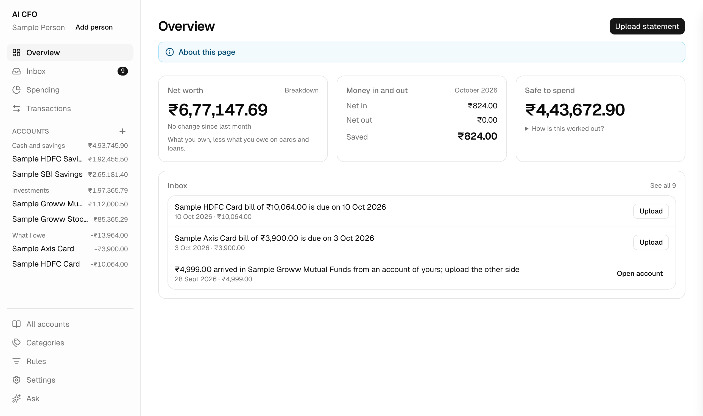
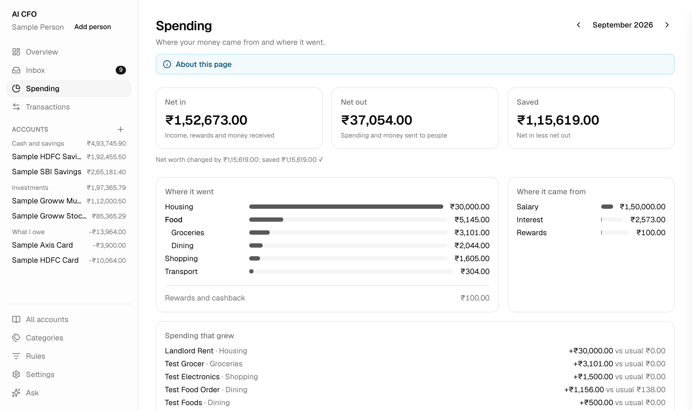
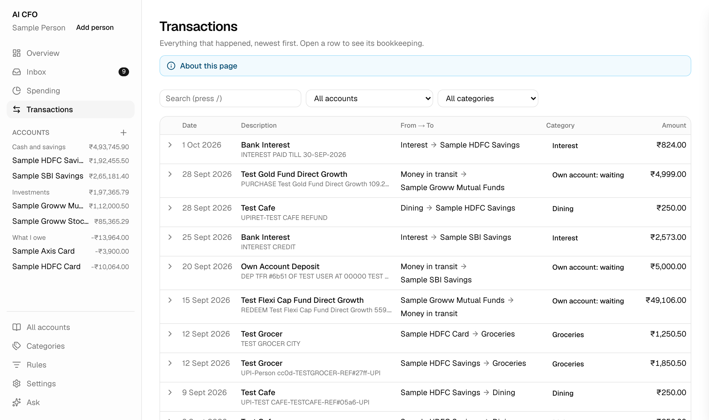
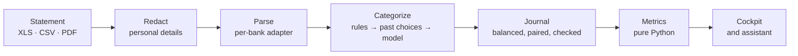

<h1 align="center">AI CFO</h1>

<p align="center">
  <strong>A private, local-first personal finance ledger with an assistant that explains your money.</strong><br />
  Upload your bank statements. Get double-entry books, figures that always agree, and answers in plain words.
</p>

<p align="center">
  <a href="https://github.com/Ishan-phys/home-finance-assistant/actions/workflows/ci.yml"></a>
  <a href="https://github.com/Ishan-phys/home-finance-assistant/actions/workflows/codeql.yml"></a>
  <a href="LICENSE"></a>
  
  
  
</p>

<p align="center">
  <a href="docs/user-guide.md">User guide</a> ·
  <a href="docs/architecture.md">Architecture</a> ·
  <a href="docs/development.md">Development</a> ·
  <a href="docs/CONTRIBUTING.md">Contributing</a>
</p>

<p align="center">
  
</p>

> Every name, account and amount in these screenshots comes from the built-in synthetic sample.

## Why

Most finance apps either want your bank login or ask you to trust a model with your numbers. AI CFO
does neither. It runs on your machine, reads the statements you download, and keeps proper
double-entry books, so net worth, spending and savings are computed by tested code and always add
up. The model only sorts transactions into categories and explains the figures, and it never sees
your name, account numbers or phone number.

## Features

- **Double-entry books.** Every transaction moves money between two accounts and sums to zero, and
  the database enforces it. Card bill payments and moves between your own accounts pair up as
  transfers, never as spending.
- **Figures that agree.** Net worth, net in and net out, savings and safe to spend come from one set
  of books. Each month carries a check line proving that the change in net worth equals what you
  saved.
- **Private by design.** Personal details are redacted from every statement *before* anything is
  stored or sent to a model. Original narrations are encrypted at rest. The app listens on
  `127.0.0.1` only.
- **Categorization you control.** Your own rules come first ("if the narration contains this, use
  that category"), then your past choices, then the model. Tick **Always do this** on any
  transaction to make a rule.
- **An assistant that cannot make numbers up.** Ask "how much can I safely spend this month?" It
  answers with figures looked up by tools over your ledger, never invented by the model.
- **Explains itself.** Every page opens with a short note on what it shows and what you can do
  there.
- **Indian banks first.** HDFC (account and credit card), SBI, Axis credit card and Groww (mutual
  funds and stocks), in XLS, XLSX, CSV and PDF. Adding a bank is a small, well-bounded change.

<table>
  <tr>
    <td></td>
    <td></td>
  </tr>
  <tr>
    <td align="center">Spending: where the month's money came from and went</td>
    <td align="center">Transactions: every row reads From → To</td>
  </tr>
</table>

## Quick start

You need [Docker](https://docs.docker.com/get-docker/).

```sh
git clone https://github.com/Ishan-phys/home-finance-assistant.git
cd home-finance-assistant
cp .env.example .env   # then, optionally, set ANTHROPIC_API_KEY or OPENAI_API_KEY in it
make up                # web on http://127.0.0.1:3000, API on http://127.0.0.1:8000
```

Open http://127.0.0.1:3000. The app asks your name, walks you through adding your accounts and
categories, then you upload statements. Without a model key, everything works except chat and
automatic categorization.

The [user guide](docs/user-guide.md) covers settings, upgrades, privacy and troubleshooting.

## How it works



A Python `uv` workspace of small packages with enforced import boundaries, a FastAPI service, a
Next.js cockpit, and PostgreSQL, all in Docker Compose. Read the [architecture](docs/architecture.md)
for the packages and the rules that hold them together.

| Layer | Built with |
| --- | --- |
| Web | Next.js 16, React 19, Tailwind CSS 4, shadcn/ui |
| API | FastAPI, Python 3.13 |
| Ledger | PostgreSQL 16, SQLAlchemy 2, Alembic |
| Assistant | Google ADK over LiteLLM, with Claude or OpenAI |
| Quality | pytest with testcontainers, Playwright, Ruff, strict mypy, CodeQL, gitleaks |

## Documentation

| | |
| --- | --- |
| [User guide](docs/user-guide.md) | Install, set up, upload statements, read the figures |
| [Development](docs/development.md) | Commands, tests and test data |
| [Architecture](docs/architecture.md) | Packages, a statement's journey, design rules |
| [HTTP API](docs/api.md) | Routes, amounts and errors |
| [Database migrations](docs/database-migrations.md) | Every revision and how to apply one |
| [Security](docs/SECURITY.md) | What is protected, the limits, and reporting |

## Contributing

Contributions are welcome, especially bank adapters and redaction improvements. Read
[CONTRIBUTING.md](docs/CONTRIBUTING.md) first. **Never commit real statements or personal data.**
AI coding agents should start with [AGENTS.md](AGENTS.md).

## License

[MIT](LICENSE) © Ishan Srivastava
