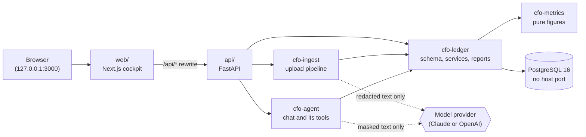

# Architecture

AI CFO is a local web app over a double-entry ledger. A statement goes in, becomes balanced
transactions, and every figure on screen is computed from those transactions by pure Python. A
language model does two narrow jobs: suggest a category for a row nobody has categorized, and
explain figures in chat. It never computes a number and never sees personal details.

## The pieces



- **web/**: Next.js and Tailwind. The browser talks only to the web app, which rewrites `/api/*`
  to the API. Every amount arrives as integer paise plus a formatted string, so the browser never
  does money maths.
- **api/**: FastAPI. Everything under `/people/{person_id}` is one person's ledger. It also
  guards the host name and rejects cross-site requests. See [the HTTP API](api.md).
- **PostgreSQL**: the only state. It runs inside Compose with no host port, and the database
  itself enforces double entry (a transaction's postings must sum to zero at commit).

## A statement's journey

`cfo-ingest` runs one upload at a time, entirely in memory:

```
unlock -> read -> redact -> parse -> categorize -> journal
```

1. **Unlock and read** (`cfo-parse`, `cfo-doc`): open a password-protected file in memory and read
   it into a neutral `Document`, whatever the format (XLS, XLSX, CSV, PDF).
2. **Redact** (`cfo-redact`): replace names, phone numbers, account numbers and UPI handles with
   pseudonym tokens. If redaction fails, the upload is rejected; unredacted text is never used.
   The original narration is kept only encrypted at rest (`cfo-vault`), for the owner to read.
3. **Parse** (`cfo-parse`): a per-bank adapter maps the document's columns to rows.
4. **Categorize**, in order: the owner's rules (`cfo-rules`), then the category remembered for
   that description, then the model (`cfo-categorize`) for what is left, else **Uncategorized**.
   Rules win over a mapping only the model made, never over a choice the owner made by hand.
5. **Journal** (`cfo-ledger`): in one database transaction, rows become balanced transactions,
   the two halves of a move between the owner's own accounts pair into one transfer, and the
   statement's closing balance becomes an assertion the books are checked against. A payment the
   owner already recorded against a card (before its statement existed) is matched first, by card
   and exact amount, and the statement's line replaces it.

## Packages

A `uv` workspace of small packages. Each declares which others it may import, and
`tools/check_imports.py` enforces that in CI. The pure packages at the bottom have no I/O.

| Package | Role | May import |
| --- | --- | --- |
| `cfo-core` | Money, dates, ids and the domain records | nothing |
| `cfo-doc` | The neutral document every statement is read into | nothing |
| `cfo-vault` | Encryption at rest for original narrations | nothing |
| `cfo-redact` | Personal-detail redaction and prompt masking | doc |
| `cfo-parse` | Unlocking, readers and per-bank adapters | core, doc |
| `cfo-categorize` | The model categorizer, behind a small port | core |
| `cfo-metrics` | Pure functions over postings: balance sheet, income statement, reconciliation, safe to spend, inbox | core |
| `cfo-rules` | The pure owner-rule engine: match text, first match wins | core |
| `cfo-ledger` | Schema, migrations, repositories, setup and journal services, reports | core, metrics, rules, vault |
| `cfo-ingest` | The upload pipeline above | core, parse, doc, redact, categorize, ledger, vault |
| `cfo-agent` | The chat agent (Google ADK over LiteLLM) and its read-only tools | core, metrics, ledger, redact |
| `cfo-testing` | Shared test support, including the throwaway PostgreSQL; never shipped | (development only) |
| `cfo-api` (`api/`) | The FastAPI app | the packages it serves |

## Rules that hold it together

- **Money is integer paise.** No floats anywhere an amount is stored or computed.
- **Every figure comes from `cfo-metrics`.** Net worth, the month's net in and net out, safe to
  spend and the inbox are pure functions over one set of postings, so they always agree. The
  Spending page's check line proves it each month: the change in net worth equals what was saved,
  plus revaluations and opening balances.
- **Models never do arithmetic.** The agent's tools return figures computed by code; the model
  only explains them.
- **Nothing leaves the machine unredacted.** Text sent to a model passes through `cfo-redact`
  first, and the model's replies are unmasked only on the way back to the owner.
- **Local only.** Web and API bind to `127.0.0.1`; PostgreSQL publishes no port.

## Where to look

| To change | Start in |
| --- | --- |
| A page in the web app | `web/src/components/<page>/` (routes in `web/src/app/`) |
| A figure | `packages/cfo-metrics/src/cfo/metrics/`, then the report in `packages/cfo-ledger/src/cfo/ledger/reports.py` |
| An HTTP route | `api/src/cfo/api/routes.py` |
| Support for a new bank | `packages/cfo-parse` (see [CONTRIBUTING](CONTRIBUTING.md#adding-a-bank-adapter)) |
| The schema | `packages/cfo-ledger/src/cfo/ledger/repositories/models.py` and a new migration ([how](database-migrations.md)) |
| What the assistant can look up | `packages/cfo-agent/src/cfo/agent/tools.py` |
