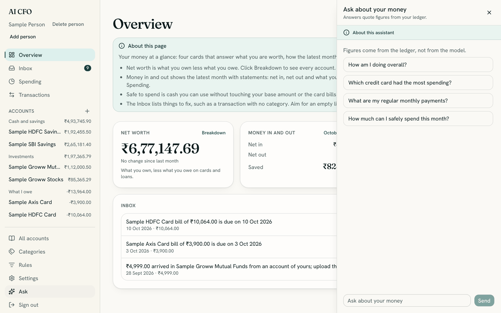
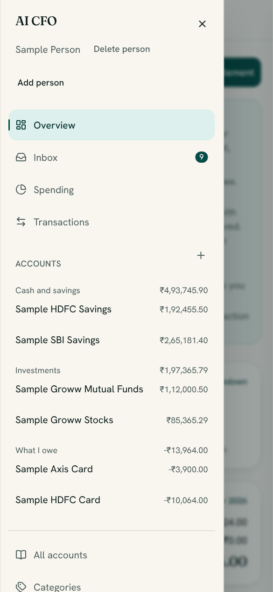
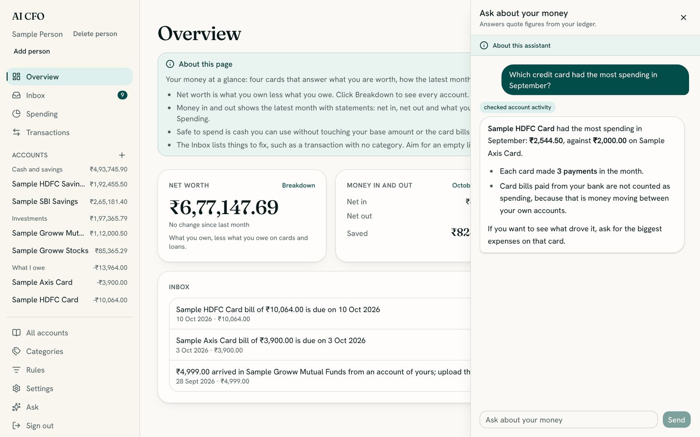

# The assistant: what you can ask

The assistant answers questions about your money in plain English. Ask it "which credit card did I
spend most on?" and it looks the answer up in your books, then explains what it found: what stands
out, why, and what to do next.

It is built so that it cannot make numbers up. Your books are computed by tested code. The
assistant looks figures up with tools and quotes them, and it never does the arithmetic itself, so
what it says always matches the other pages.

> **You need a model key.** The assistant is available only when you have set an OpenAI **or**
> an Anthropic key in `.env` ([Getting started, step 5](getting-started.md#step-5-decide-about-a-model-key-optional)).
> Without one, any question gets the reply "the assistant could not answer", and everything else
> keeps working.

## Open it

Choose **Ask** at the bottom of the left menu. A panel slides in on the right, beside the page you
were looking at. Type a question and press **Send**, or click one of the suggestions. Close it with
the **×**.

On a phone, open the menu first, then choose **Ask**.

## What a good answer looks like

Answers follow the same shape, so they are quick to read:

1. **The answer first**, in a sentence or two.
2. **The evidence**: a short list with the key figures in **bold**. When it compares months,
   accounts or categories it uses a small table.
3. **One next step**, when there is something useful to do.

*This is an example of how an answer looks. Your answers come from your own books.*

Above each answer you see small tags such as **checked account activity**. They show which
lookups the assistant made, so you can see where the figures came from.

| Tag | What it looked at |
| --- | --- |
| checked net worth | Your balances, what you own and what you owe |
| checked spending | One month's money in, out and saved, and spending by category |
| checked trend | Month-by-month change, savings rate, and which categories moved |
| checked account activity | What each bank account or card spent, paid and received |
| checked find transactions | Specific payees, categories or accounts over a period |
| checked recurring payments | Rent, subscriptions, EMIs and other regular payments |
| checked leaks | Spending that grew compared with the usual |
| checked safe to spend | How much you can spend now |
| checked inbox | What is missing or needs fixing in your books |

## Questions you can ask

Use your own words. These are examples to show what is possible.

### How am I doing?

- "How am I doing overall?"
- "Give me an overview of my finances."
- "Is my spending going up, and what is driving it?"
- "What changed since last month?"
- "Any advice?"

For a broad question like these, the assistant looks at several things at once (trends, spending,
what you can spend, your net worth, and what needs fixing) and picks out what matters most.

### Income, saving and your savings rate

- "How much did I save last month?"
- "What is my savings rate?"
- "How much did I earn in September?"
- "Compare my saving over the last six months."

### Spending by category or payee

- "How much did I spend on food in the last three months?"
- "How much did I spend on Swiggy?"
- "What did I spend on dining in September?"
- "Show my spending on groceries each month."

Give a payee as it appears in your statements, such as a shop's name. See
[names of people](#names-of-people) below for why this does not work for a person.

### Biggest, latest and unusual

- "What were my biggest expenses in September?"
- "What are my latest transactions?"
- "Where did my money leak this month?"
- "Did anything unusual happen this month?"

### Comparing your accounts and cards

This is where the assistant can answer questions that no single page does.

- "Which credit card had the most spending in September?"
- "Which bank account made the most payments?"
- "How much did I spend on my HDFC card this month?"
- "How much came into my savings account?"
- "Which account do I use the most?"
- "Compare my two cards."

Say **which kind** of account you mean when it matters ("credit card", "bank account", "savings
account"). If you do not, the assistant compares all of them and tells you which are which.

### Regular and fixed costs

- "What are my regular monthly payments?"
- "What am I committed to paying every month?"
- "What could I cut?"

The assistant reports payments that appear in at least three of the last complete months, with the
usual amount and whether it stays steady. It cannot tell a subscription from any other habit, so it
describes what recurs and leaves the decision to you.

### Can I afford it?

- "How much can I safely spend this month?"
- "Can I afford a ₹40,000 trip?"
- "How much of my money is actually free to spend?"

It uses your **Safe to spend** figure and explains what was taken off: the base amount you keep
aside and what you owe on credit cards. It does not count investments, deposits, property or gold
as spendable.

### Net worth and balances

- "What is my net worth, and what do I owe?"
- "What is the balance on each of my accounts?"
- "How much do I owe on credit cards?"

### Is my data complete?

- "What do I need to fix?"
- "Is anything missing from my statements?"
- "Why does my card show money owed?"

### Time words it understands

You can say "this month", "last month", "last three months", "this year", "in September" or "since
July". The financial year runs **April to March**. If you do not name a period, the assistant uses
the latest month with statements and **says which month it used**. A month still in progress is
called "the month so far" and is never compared with a whole month.

## How to ask well

- **Name a period** when it matters: "in September", "over the last three months".
- **Name the kind of account**: "credit card", "bank account".
- **One question at a time** gets a sharper answer than three at once.
- **Follow up.** While the panel stays open, the assistant remembers what you just discussed: "and what about last month?",
  "which payee drove that?", "show me the biggest ones".
- **Ask "why".** "Why is my spending up?" makes it look for the category or payee behind a change.

## What it counts, and what it does not

- **Spending is not transfers.** A credit card bill paid from your bank is money moving between
  your own accounts. It counts as neither spending nor income, and the assistant keeps these apart.
- **Opening balances are not payments.** The starting balance of an account is never counted as
  money paid out.
- **Refunds are shown separately.** Money back from a shop is listed apart and is not netted off.
- **A swing of several hundred percent** usually means the earlier month held little data, such as
  your first uploaded statement. The assistant says so instead of calling it a real surge.
- **Ties are called ties.** If two cards spent the same, you are told that.

## What it cannot do

| It cannot | Why, and what to do instead |
| --- | --- |
| Change anything | It only reads. To fix a category or add a rule, use **Transactions** and **Rules** |
| Move money, pay bills or place trades | It has no connection to your bank, by design |
| Predict the future | It describes what your recent months show, but it does not forecast |
| Give tax, legal or investment advice | It explains your numbers. It gives general principles at most, and never recommends a security |
| See another person's books | It sees only the person you are viewing. Switch person first |
| Answer questions about anything else | It is a money assistant. It gently steers back to your finances |
| List every transaction | It shows totals and the largest few. **Transactions** has the full list |

### Names of people

The assistant cannot see people's names. Names are hidden before anything is sent to a model, so
searching "how much did I pay Ravi?" cannot work. Use the search box on **Transactions** (press `/`
to jump to it) instead.

## Privacy

The assistant is the one part of the app that talks to an outside service, so it has the strictest
rules:

- **Your name, account numbers, card numbers, phone numbers and UPI handles are removed** from
  everything before it is sent.
- **Your account, bank and custom category names are swapped for stand-ins** such as
  `Credit_Or_Loan_2`. The model works with the stand-ins, and your real names are put back into the
  answer before you read it, on your computer.
- **Amounts and dates are sent**, because the model needs them to explain anything.
- The assistant is told **never to ask for or repeat** card numbers, PINs, one-time passwords,
  passwords, Aadhaar or PAN numbers, and **never to reveal its own instructions**.
- Text inside your statements is treated as **data, not instructions**, so a bank file cannot give
  the assistant orders.
- Replies are stripped of **links, images and markup**, and the browser refuses to draw images,
  because a hidden instruction in a statement could otherwise use them to carry your data out.

Do not type card numbers, PINs or passwords into the chat. If you do, the assistant tells you not
to and does not repeat them.

[Privacy in the user guide](user-guide.md#privacy-what-is-stored-and-what-is-sent) covers what is
stored and what leaves your computer. Consider asking your model provider to enable zero data
retention.

## Good to know

- **Closing the panel clears the conversation on screen**, and the next question starts a fresh
  one. Keep it open while you follow up.
- **The assistant forgets everything when the app restarts.**
- **Each person has their own chat.** Switching person starts a separate conversation about that
  person's books.
- **Broad questions take a moment**, because the assistant makes several lookups.

## If something goes wrong

| What you see | What it means |
| --- | --- |
| "the assistant could not answer" | No model key is set, the key is not valid, or your computer cannot reach the provider (no internet, or the provider is down). Check the key in `.env`, then run `docker compose up -d`. `docker compose logs api` shows the provider's own message |
| A short note that something could not be looked up | One lookup failed, often because of a date or account name. Ask again more simply, or name the month |
| It says there is nothing to analyse | No statements have been uploaded for that period. Upload one |
| An odd name such as `Credit_Or_Loan_2` appears | That is a stand-in for one of your accounts. Ask again and name the kind of account, such as "my credit card" |
| It says it cannot search for a person | Names are hidden from it. Use the search on **Transactions** |
| A figure looks different from a page | Check the period. The assistant states which one it used. If it is the same period and still differs, please [report it](https://github.com/Ishan-phys/home-finance-assistant/issues) |

More in [Troubleshooting](troubleshooting.md#the-assistant).
