# Getting started with AI CFO

This page takes you from nothing to your first answer from the assistant. You do not need to be a
programmer. You do need to type a few commands into a terminal, and every one of them is written
out for you to copy.

AI CFO runs on **your own computer**. It reads the statements you download from your bank, sorts
every transaction into categories, shows what you own, what you owe and where your money went,
and lets you ask questions in plain English. Nothing is uploaded to a website, and the app never
asks for your bank login.

## Choose your route

| | **Route A: look around first** | **Route B: use my own statements** |
| --- | --- | --- |
| Time | About 15 minutes (most of it is the first build) | About 30 to 40 minutes |
| You need | Docker, and these steps: 1 to 7, then 8 | Docker, your bank and card statements, and every step |
| Model key | Not needed | Optional, but you will want one (see step 5) |
| You get | A pretend person with sample accounts, to click around in | Your own books |

Route A is the safe way to find out whether the app is for you. Everything in it is invented. You
can delete it afterwards and start Route B on a clean slate.

## How each step is laid out

- **Do** is what to type or click.
- **You should see** is what success looks like, so you know you can move on.
- **If it does not work** points at the usual cause. [Troubleshooting](troubleshooting.md) has
  the full list.

---

# Part 1: Install and start the app

## Step 1. Install Docker

Docker is the program that runs AI CFO for you, so you do not have to install a database or any
programming tools yourself.

**Do**

1. Install **Docker Desktop** from <https://docs.docker.com/get-docker/> (Windows and macOS), or
   Docker Engine with the Compose plugin (Linux). You need Docker Compose **2.24 or newer**;
   Docker Desktop includes it.
2. Open Docker Desktop and leave it running. You should see a whale icon in your menu bar or
   system tray.
3. Open a terminal:
   - **macOS:** Terminal (press `Cmd` + `Space`, type "Terminal").
   - **Windows:** PowerShell (press the Windows key, type "PowerShell").
   - **Linux:** any terminal.
4. Check that Docker works:

```sh
docker --version
docker compose version
```

**You should see** two lines, each with a version number. The second (Compose) should be 2.24 or
newer.

**If it does not work.** "command not found" or "not recognized" means Docker is not installed or
its program is not on your path. Close and reopen the terminal after installing. An error about
the "daemon" or "pipe" means Docker Desktop is not running yet. Start it and wait for the whale
icon to settle.

## Step 2. Get the app

**Do.** If you have Git:

```sh
git clone https://github.com/Ishan-phys/home-finance-assistant.git
cd home-finance-assistant
```

No Git? Open <https://github.com/Ishan-phys/home-finance-assistant>, choose **Code**, then
**Download ZIP**. Unzip it, then in your terminal move into the folder (the one that contains
`docker-compose.yml`):

```sh
cd path/to/home-finance-assistant
```

**You should see.** Typing `ls` (macOS, Linux, PowerShell) lists files including
`docker-compose.yml`, `.env.example` and `README.md`.

Every command from here on is run **from inside this folder**.

## Step 3. Create your settings file

The app reads its settings from a file called `.env` in this folder. A template is included.

**Do**

```sh
cp .env.example .env
```

(Windows Command Prompt, not PowerShell: `copy .env.example .env`.)

**You should see** no output, and a new file called `.env`. Files that start with a dot are
hidden in some file managers. That is normal.

> **Keep `.env` private.** It will hold your sign-in details and, if you add one, a model key.
> Never share it, never post it, and never commit it to Git. It is already ignored by Git.

## Step 4. Set up your sign-in

AI CFO holds your finances, so it asks you to sign in. You choose a username and a password once.
The app stores only a scrambled form of the password (a "hash"), never the password itself.

You will fill in three lines in `.env`:

| Line | What it is |
| --- | --- |
| `OWNER_USERNAME` | Any username you like, such as `asha` |
| `OWNER_PASSWORD_HASH` | The scrambled form of your password, which the next command makes for you |
| `SESSION_SECRET` | A long random string that keeps your signed-in session safe |

### 4a. Make the password hash

**Do.** Run this and follow the prompts. Pick a password of **at least 12 characters**.

```sh
docker compose run --rm --no-deps api python -m cfo.api.auth
```

The first time, Docker builds the app and prints a lot of text. This can take several minutes and
is normal. Then you see:

```text
Choose the owner password:
Type it again:
```

Nothing appears on screen as you type. That is normal, because the password is hidden. Type it,
press Enter, type it again, press Enter.

**You should see** one long line that starts with `scrypt$`. That is your hash. Select it and
copy it.

**If it does not work.** "The two passwords do not match" means you mistyped one. Run the command
again. "Use at least 12 characters" means the password is too short.

> **Already have Python and `uv` installed?** You can use `uv run python -m cfo.api.auth`
> instead. The result is the same.

### 4b. Make the session secret

**Do**

```sh
docker compose run --rm --no-deps api python -c "import secrets; print(secrets.token_urlsafe(48))"
```

**You should see** one line of random-looking letters and numbers. Copy it. (Any random text of at
least 32 characters works, and so does a password manager's generator.)

### 4c. Put them in `.env`

**Do.** Open `.env` in a plain text editor:

- **macOS:** `open -e .env`
- **Windows:** `notepad .env`
- **Linux:** `nano .env`

Find these three lines and fill them in:

```sh
OWNER_USERNAME=asha
OWNER_PASSWORD_HASH='scrypt$32768$8$1$...paste the whole hash here...'
SESSION_SECRET=...paste the random string here...
```

Save the file.

**Three things people get wrong:**

1. **Keep the single quotes around the hash.** It contains `$` signs, and without the quotes they
   are silently deleted and you can never sign in.
2. **No spaces around the `=`.** `OWNER_USERNAME=asha`, not `OWNER_USERNAME = asha`.
3. **Leave every other line exactly as it is.** The defaults are right for now.

## Step 5. Decide about a model key (optional)

The app uses an AI model for two jobs: **sorting transactions into categories** while you upload,
and **answering your questions** in the Ask panel. Python computes every figure either way. The
model never calculates anything, and it never sees your name or account numbers.

| | No key | With a key |
| --- | --- | --- |
| Statements import | Yes | Yes |
| Every figure and page | Yes | Yes |
| Transactions get a category | **You choose each one yourself** (you can make rules to speed this up) | Sorted for you, and you correct the odd one |
| The Ask assistant | **Not available** | Yes |

You can start with no key and add one later. Route A needs none.

**To add one**, you need an account with a model provider that gives you an **API key**. A chat
subscription is not the same thing as an API key. Use **one** of these (never both, because the
app refuses to start if both are set):

- **OpenAI:** create a key at <https://platform.openai.com/api-keys>. Put it on the line
  `OPENAI_API_KEY=` in `.env`.
- **Anthropic (Claude):** create a key at <https://console.anthropic.com/>. Put it on the line
  `ANTHROPIC_API_KEY=` in `.env`.

Model providers charge per use. Keep the key private like a password.

## Step 6. Start the app

**Do**

```sh
docker compose up -d --build
```

On macOS and Linux, `make up` does the same once the images exist. The first start downloads and
builds everything, which takes several minutes. Later starts take seconds.

Check that it is running:

```sh
docker compose ps
```

**You should see** three services, `db`, `api` and `web`, each shown as running. Once they have
settled, each says `healthy`. This can take about a minute after the build.

Now open **<http://127.0.0.1:3000>** in your browser.

**If it does not work.**

- The page will not load: wait a minute and refresh. Then run `docker compose logs api` and read
  the last lines. A message starting `both OPENAI_API_KEY and ANTHROPIC_API_KEY are set` means
  you set two keys. Remove one.
- "Port is already allocated" means something else is using port 3000 or 8000. Stop that program,
  or see [troubleshooting](troubleshooting.md#the-app-will-not-start).

## Step 7. Sign in

**You should see** the sign-in page.

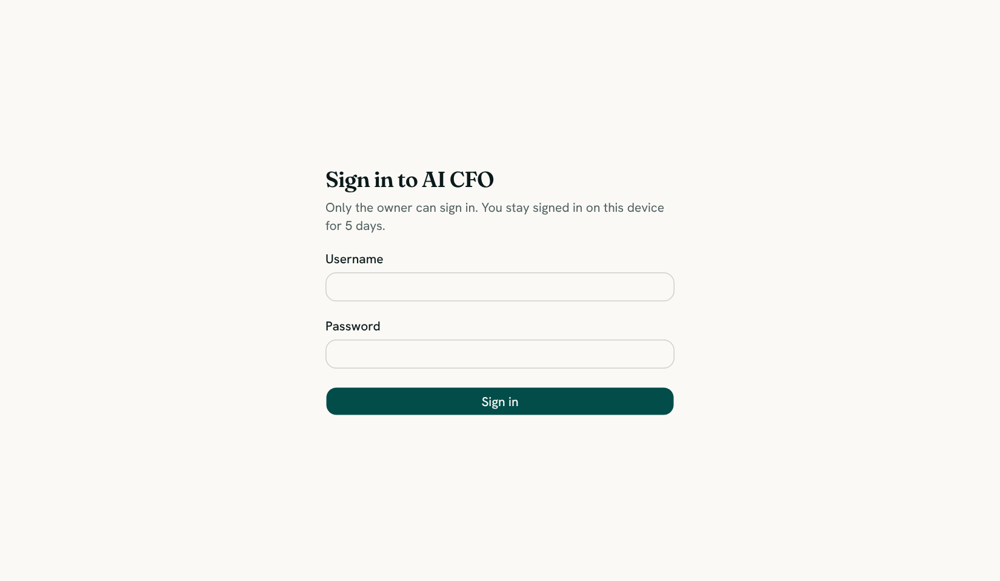

**Do.** Enter the username from `.env` and the **password you typed in step 4a** (not the long
hash). Choose **Sign in**.

You stay signed in on this browser for 5 days. **Sign out** is at the bottom of the left menu.

**If it does not work.**

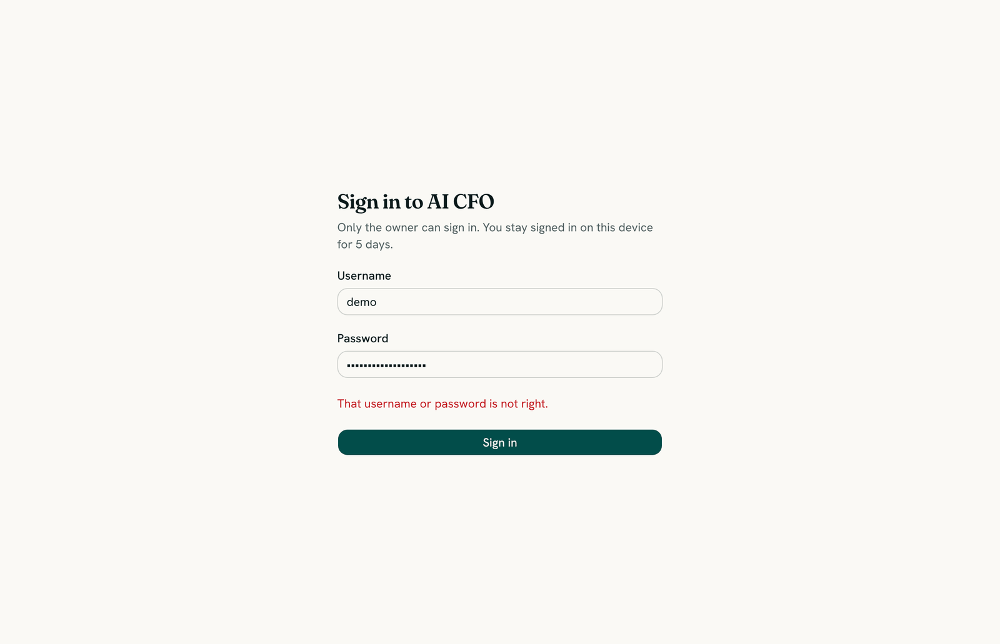

- "That username or password is not right." Check the username exactly as written in `.env`.
  Remember it is the password you chose, not the hash.
- "Too many failed sign-in attempts. Wait 15 minute(s) and try again." Five wrong attempts lock
  the form for 15 minutes, even for the right password. Wait it out.
- "Sign-in is not set up: OWNER_USERNAME and OWNER_PASSWORD_HASH must be set in .env". A line in
  `.env` is empty. Fix it, then run `docker compose up -d` so the app picks the change up.
- "SESSION_SECRET must be at least 32 characters". Make a longer secret (step 4b).
- You sign in and are immediately sent back to the sign-in page. See
  [troubleshooting](troubleshooting.md#i-sign-in-but-land-back-on-the-sign-in-page).

---

# Part 2: Set up your books

## Step 8. Introduce yourself (or load the sample)

After signing in, the first screen asks who you are.

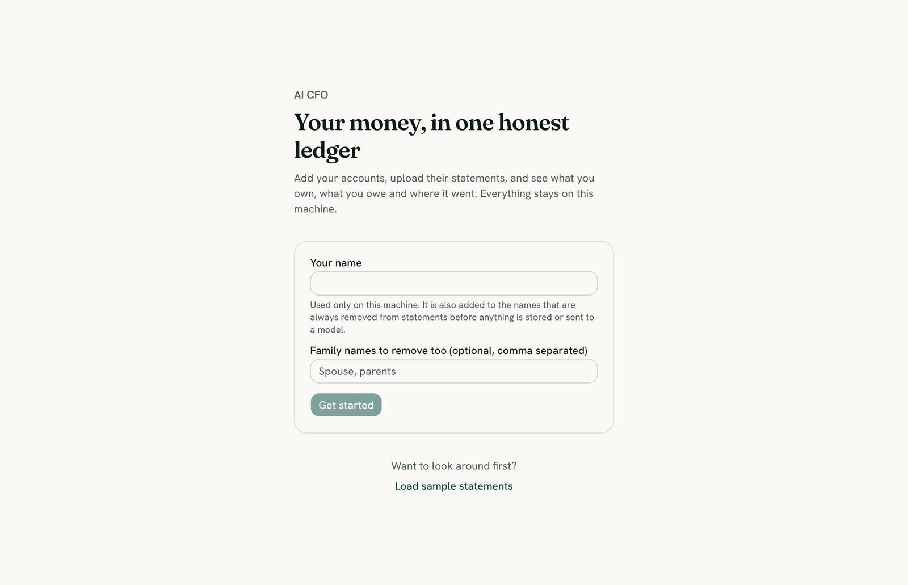

### Route A: look around with sample data

Choose **Load sample statements** (the small link under the form). The app creates a pretend
person with six accounts and seven statements. You land on the **Overview**. Skip ahead to
[step 15](#step-15-read-your-overview) to see what the pages mean, and try the questions in
[step 16](#step-16-ask-your-first-question) if you set a key.

When you are done exploring, choose **Delete person** under the name at the top of the left menu,
type the name to confirm, and the sample is gone. Then start again from this step for Route B.

### Route B: your own books

**Do**

1. **Your name.** Type your name. It is stored only on your computer, and it is added to the
   list of names that are **always removed** from statements before anything is stored or sent
   to a model.
2. **Family names to remove too** (optional). Add the names of people who appear in your
   statements, separated by commas: spouse, parents, a flatmate. They are removed the same way.
3. Choose **Get started**.

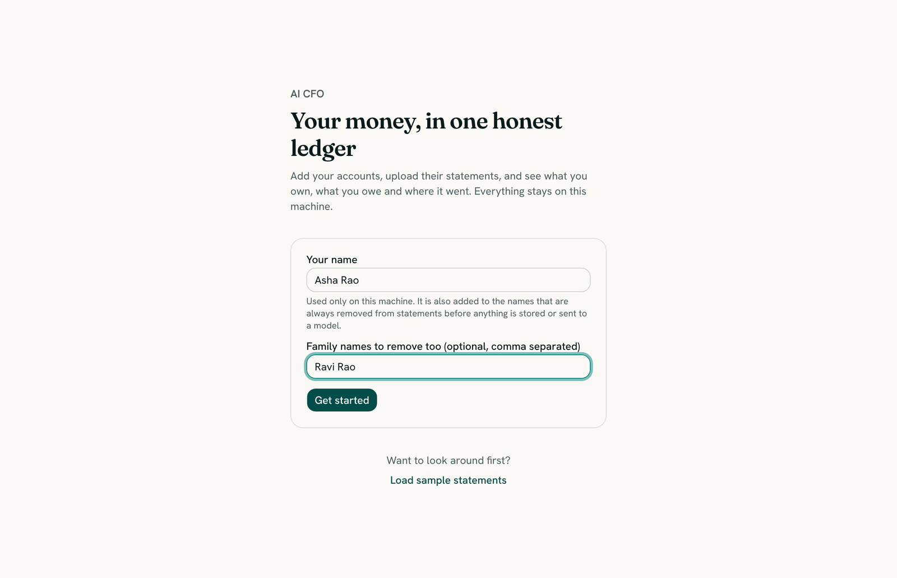

## Step 9. Add your accounts

The setup runs in four short steps, with a progress bar at the top.

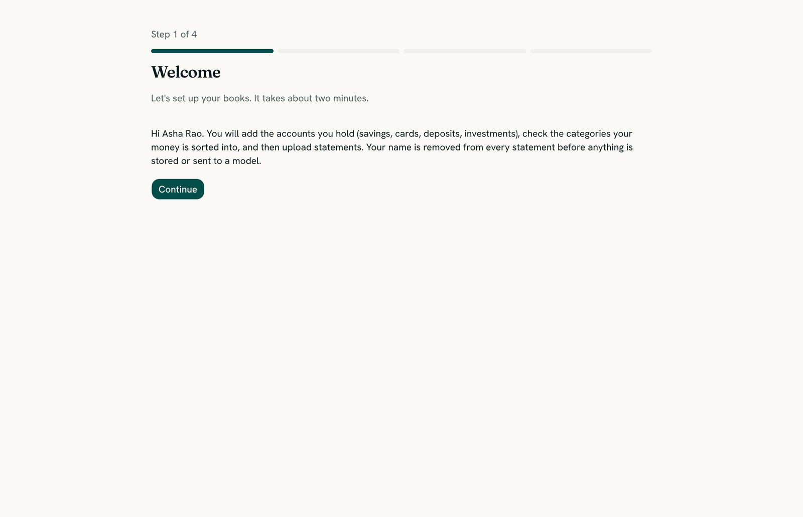

Choose **Continue**. Now add each account you hold: savings accounts, credit cards, fixed deposits
and so on. Statements are uploaded into these accounts.

**Do.** For each account, fill in the form:

| Field | What to pick |
| --- | --- |
| **Type** | Savings account, Current account, Cash, Credit card, Loan, Fixed deposit, Recurring deposit, Mutual funds, Stocks, Property or Gold |
| **Bank or provider** | Choose your bank. If it is not in the list, choose **Something else** and type its name |
| **Name** | Leave blank to use the suggestion (such as "HDFC Bank Savings account"), or type your own, such as "HDFC Swiggy Card" |

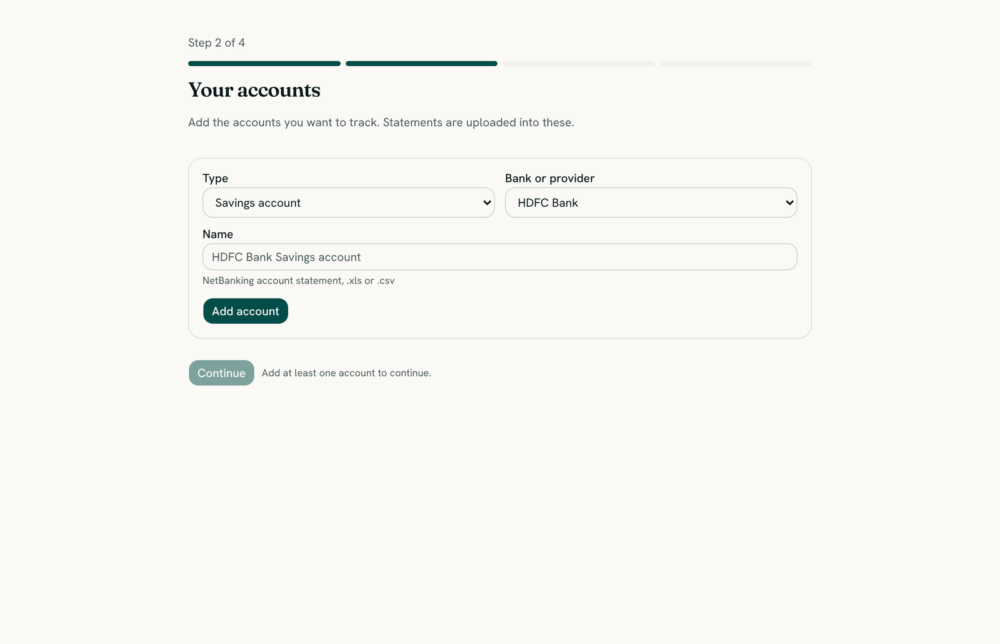

The small line under **Name** tells you what kind of account this is:

- **A statement hint**, such as "NetBanking account statement, .xls or .csv", means the app can
  read that bank's statements. You will upload files into this account.
- **"You enter its value by hand"** means the app has no statement format for it: a deposit,
  property, gold, or a bank the app cannot read yet. You give it a **Current value** and an **As
  of** date, and you update the value yourself whenever it changes.

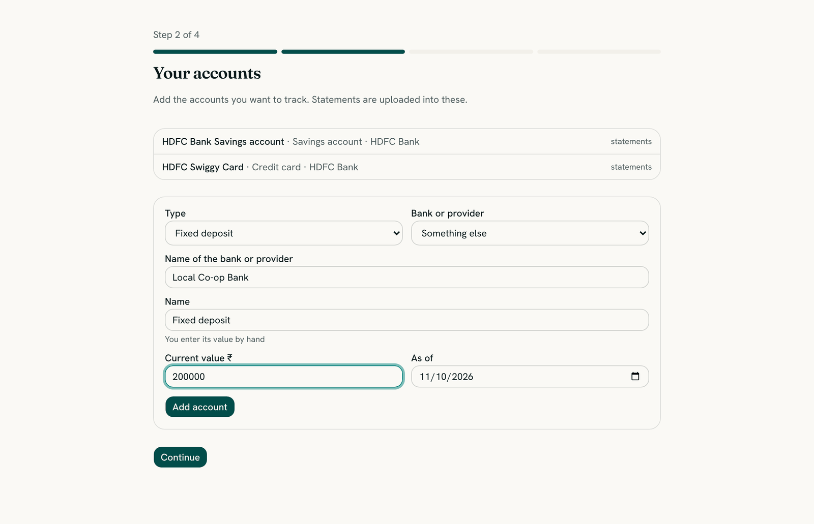

Choose **Add account**. It appears in the list above the form. Add every account you want to
track. You can add more later with the **+** next to **Accounts** in the left menu.

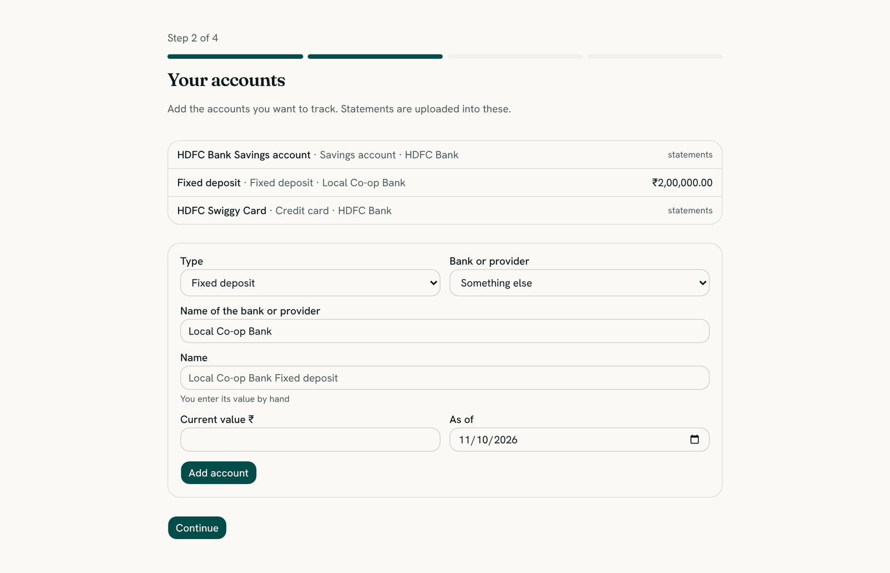

> **Tip: add your cards too.** Card statements and bank statements describe the same card bill
> from two sides. With both uploaded, the app matches them into one transfer, so the bill is not
> counted as spending twice.

When you have at least one account, choose **Continue**.

## Step 10. Look at your categories

Categories are the buckets your money is sorted into: Groceries, Dining, Housing, Salary and so
on. The app comes with a sensible set, split into **Money out** and **Money in**.

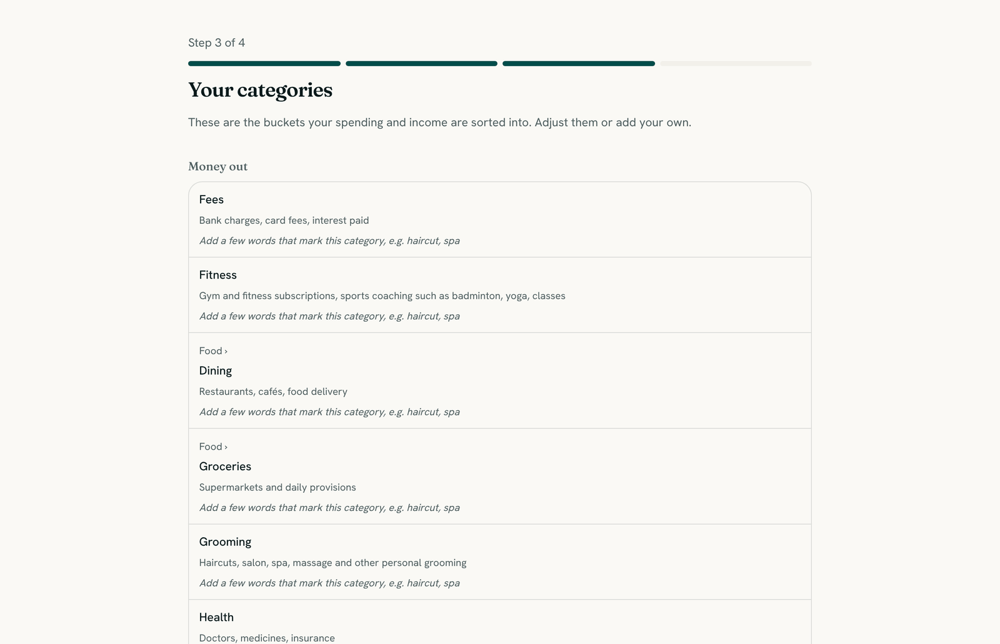

**Do.** You can accept them as they are, which is a good choice for now. If you want to change
something:

- Click a **name** or **description** to edit it.
- Choose **＋ Add category** to make your own. Give it a name, say whether money goes out or in,
  optionally put it inside another category, and write one line on what it is for. That line
  is what the model reads when it sorts, so a clear description gives better results.

Choose **Use these categories**.

## Step 11. Finish setup

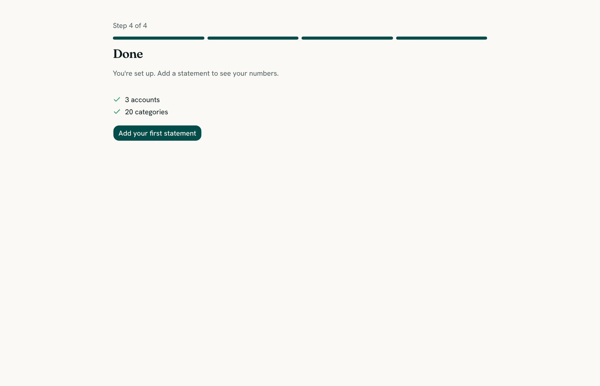

**You should see** a tick beside the number of accounts and categories. Choose **Add your first
statement**. The app opens your first account with the upload window ready.

---

# Part 3: Your first statement

## Step 12. Download a statement from your bank

**Do.** Sign in to your bank's website or app as you normally would, and download a statement for
**one account, for one complete month**. Which file to ask for:

| Account | Download | File type |
| --- | --- | --- |
| HDFC Bank savings or current | NetBanking account statement | `.xls` or `.csv` |
| HDFC credit card | The billed card statement | `.xls` or `.xlsx` |
| SBI savings or current | Account statement | `.xls`, `.xlsx` or `.csv` |
| Axis credit card | The monthly card statement | `.pdf` |
| Groww | Holdings statement or order history | `.xlsx` |

Rules that save you trouble:

- **Use the file exactly as the bank gave it.** Do not open it and re-save it. Editing can change
  its layout so the app no longer recognises it.
- **Do not rename the extension** to make it "fit". The app reads the real contents.
- **One account per file.** A savings statement goes into the savings account, a card statement
  into the card.
- **Start with a recent complete month.** You can add older months later in any order.
- **A password-protected file is fine.** The app asks for the password when you upload.
- Files can be up to 10 MB and 20,000 rows.

[Statements](statements.md) covers every bank in detail, including what each file looks like and
what to do when your bank is not on the list.

## Step 13. Upload it

**Do.** If you came from step 11, the upload window is already open on your first account.
Otherwise open the account and choose **Upload statement**.

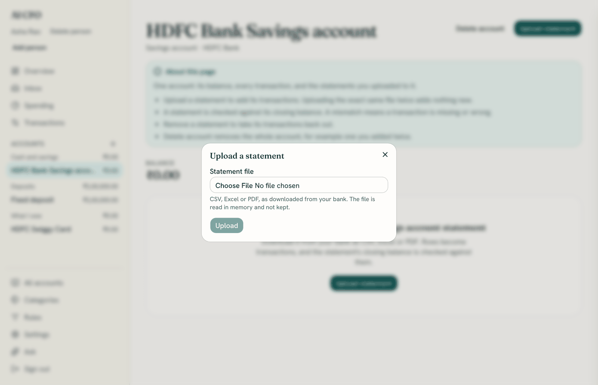

Choose the file (the button reads **Choose File**), then choose **Upload**. If the file is
password-protected, a **File password** box appears. Enter it and choose **Upload** again.

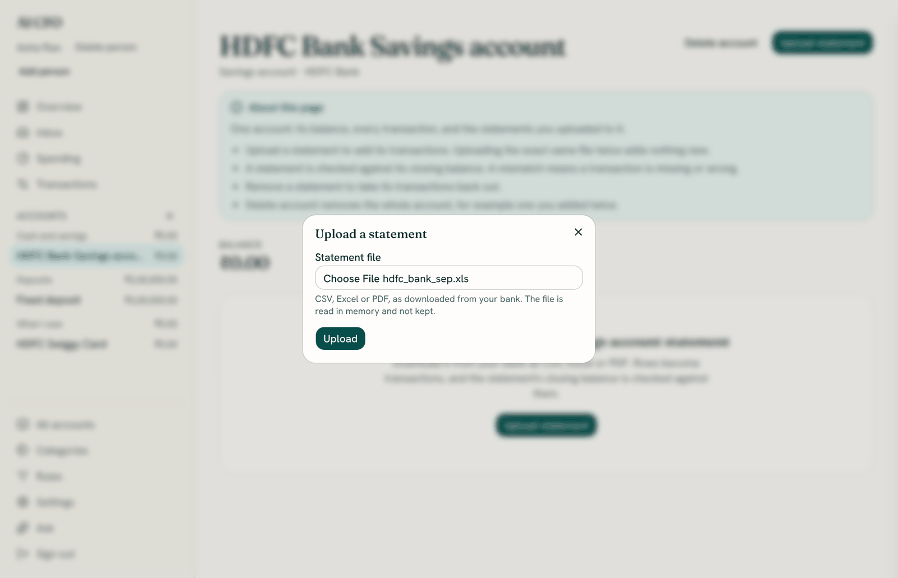

The file is read in memory, with personal details removed first. It is never kept.

**You should see** a summary:

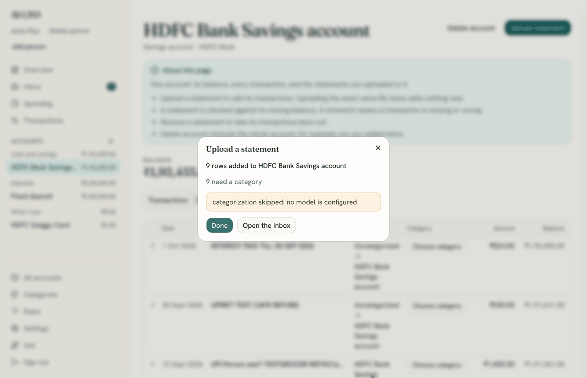

| Line | What it means |
| --- | --- |
| **N rows added to your account** | New transactions now in your books |
| **N were already there** | Rows from an earlier upload that overlaps this one. Nothing is counted twice |
| **N matched a movement from another of your accounts** | A bank-to-card payment found on both statements and joined into one transfer |
| **N need a category** | Rows the app could not sort. They are waiting in the Inbox |
| **The statement balance does not match** | A statement is probably missing before this one. See step 14 |

If you set no model key, you will see **"categorization skipped: no model is configured"**, and
every row needs a category. That is expected without a key. The next step shows how to sort them.

**If it does not work.** The message says what is wrong and what to upload instead. The
[statements guide](statements.md#when-an-upload-is-refused) lists each message and its fix.

## Step 14. Clear the Inbox

The **Inbox** (in the left menu, with a number beside it) lists everything the app could not
settle by itself, each with its fix next to it. Your goal is an empty list.

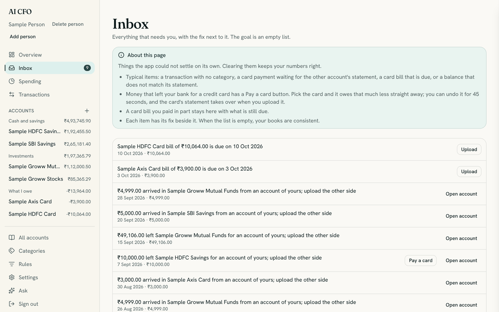

The common items:

| Item | What to do |
| --- | --- |
| **Needs a category** | Choose **Choose category** and pick one. The app remembers your choice for the same description |
| **Left … for an account of yours** or **Arrived in … from an account of yours** | Money moved between your own accounts. Upload the other account's statement and the two halves join. If the money did not move between your accounts, pick a category instead |
| **Card bill … is due** | A reminder that stays until your payments cover the bill |
| **… is short of its statement** | A statement is missing between two you uploaded. Upload it |
| **Pay a card** button | The money left your bank to pay a credit card. See [Paying a credit card](user-guide.md#paying-a-credit-card) |

### Choosing a category, and making a rule

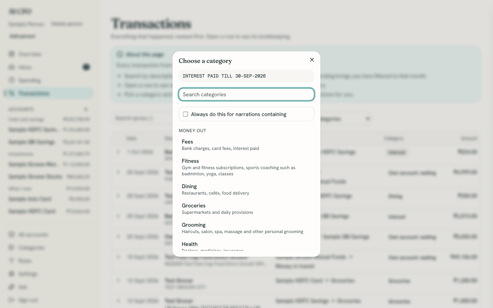

Tick **Always do this for narrations containing** and type the text (for example a payee's name).
The app saves it as a **rule**. From now on, any transaction containing that text gets the
category automatically, in this and every future statement. Rules are the fastest way to clear the
Inbox without a model key. [Rules](user-guide.md#rules) explains how they work.

## Step 15. Read your Overview

Choose **Overview** in the left menu.

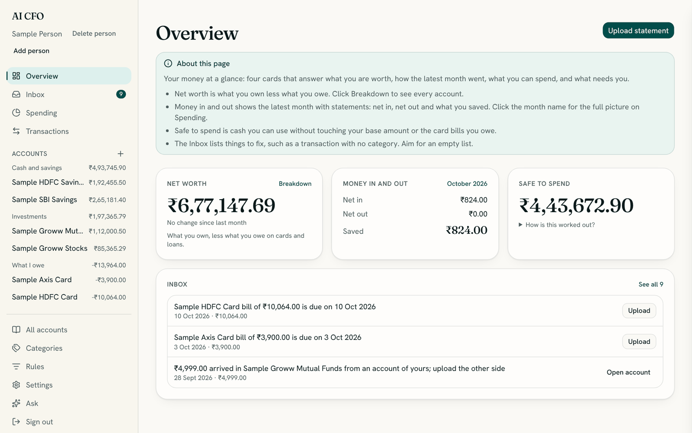

| Card | What it tells you |
| --- | --- |
| **Net worth** | Everything you own, minus everything you owe on cards and loans. **Breakdown** lists every account |
| **Money in and out** | The latest month with statements: money **in**, money **out**, and what you **saved** (in minus out). The month name opens the full picture on **Spending** |
| **Safe to spend** | Cash you can use without touching your safety cushion or the card bills you owe |
| **Inbox** | The top items that still need you |

Click **How is this worked out?** under Safe to spend to see each step.

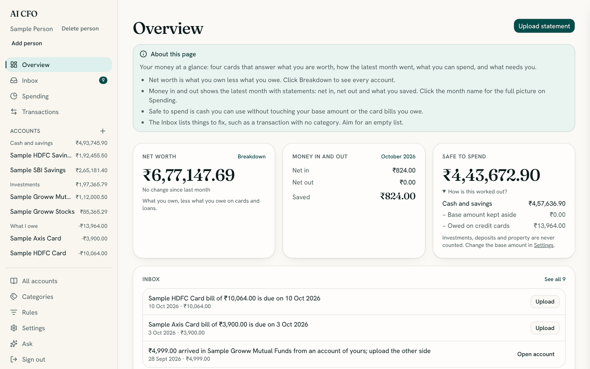

Safe to spend starts out cautious or generous depending on two numbers you set yourself. Open
**Settings** and choose a **Base amount kept aside** (an emergency cushion that is never counted
as spendable) and, if you want one, a **Monthly allowance** (the most you mean to spend in a
month).

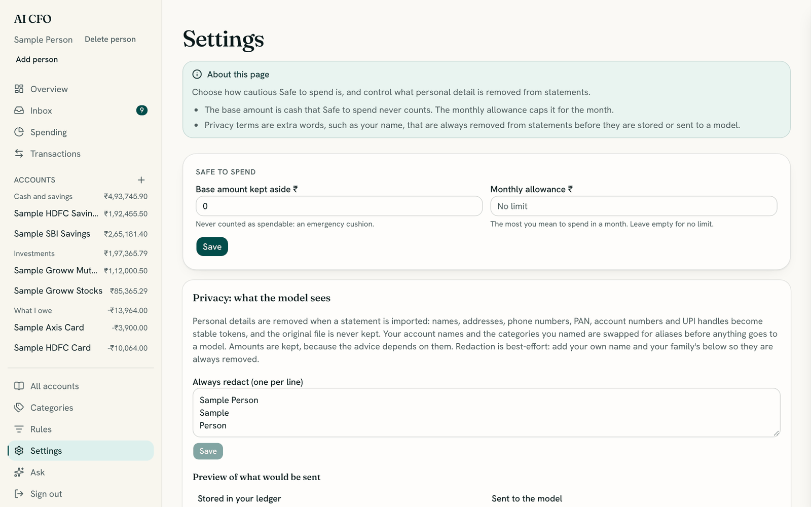

Other pages worth a look now: **Spending** (where one month's money went), **Transactions** (every
row, searchable), and **All accounts** (your books in accounting terms). The
[user guide](user-guide.md) explains each.

---

# Part 4: Ask the assistant

## Step 16. Ask your first question

You need a model key for this (step 5). Without one, a question gets the reply "the assistant
could not answer", and everything else keeps working.

**Do.** Choose **Ask** at the bottom of the left menu. A panel opens on the right. Click a
suggested question, or type your own and press **Send**.

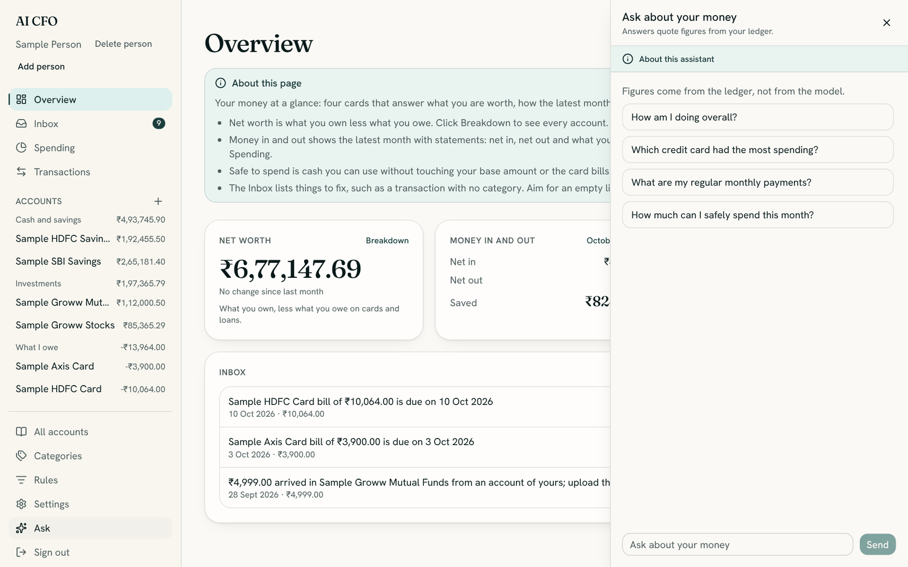

Good first questions:

- "How am I doing overall?"
- "Which credit card had the most spending?"
- "How much can I safely spend this month?"
- "What are my regular monthly payments?"

**You should see** small tags such as "checked account activity", which show what the assistant
looked up, then an answer with the key figures in bold.

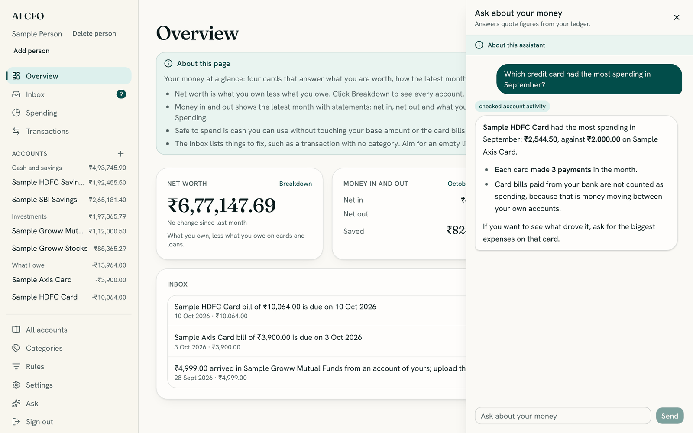

*This is an example of how an answer looks. Your answers come from your own books.*

The [assistant guide](assistant.md) lists many more questions you can ask, explains how to read an
answer, and says what the assistant cannot do.

---

# Part 5: Keep it going

## Step 17. A simple monthly routine

| When | What to do |
| --- | --- |
| Start of each month | Download last month's statement for each account and upload each into its account |
| After uploading | Open the **Inbox** and clear it |
| Any time | If you have deposits, property or gold, open the account and choose **Update value** |
| Mid-month | Check **Safe to spend** on the Overview, or ask the assistant |

You do not have to upload everything at once or in order, and uploading the same file twice adds
nothing.

## Step 18. Everyday commands

You will use these from the app's folder. Where a `make` shortcut exists (macOS and Linux), it
does the same thing.

| To | Run |
| --- | --- |
| **Stop** the app (your data is kept) | `docker compose stop` |
| **Start** it again | `docker compose up -d` |
| Check what is running | `docker compose ps` |
| Read the logs, to find out why something failed | `docker compose logs api` |
| Apply a change to `.env` | `docker compose up -d` |
| **Back up** your data to `backup.sql` | `docker compose exec -T db pg_dump -U cfo -f /tmp/backup.sql cfo`, then `docker compose cp db:/tmp/backup.sql backup.sql` |
| **Update** to a newer version | `git pull`, then `docker compose up -d --build` |

Your data lives in a Docker "volume" on your computer. It survives stopping and restarting. Two
commands **delete it for good**: `docker compose down -v` and `make reset`. Do not run them unless
you mean to erase everything.

Back up before updating, and keep `backup.sql` private, because it contains your financial data.
[Configuration](configuration.md) covers backups, restoring, and a second key you must also back
up.

## Where to go next

| I want to | Read |
| --- | --- |
| Understand every page and feature | [User guide](user-guide.md) |
| Know what to download for each bank | [Statements](statements.md) |
| Learn what the assistant can answer | [Assistant guide](assistant.md) |
| Change a setting, add a second person, or back up | [Configuration](configuration.md) |
| Fix something that went wrong | [Troubleshooting](troubleshooting.md) |
| Look up a word | [Glossary](glossary.md) |
