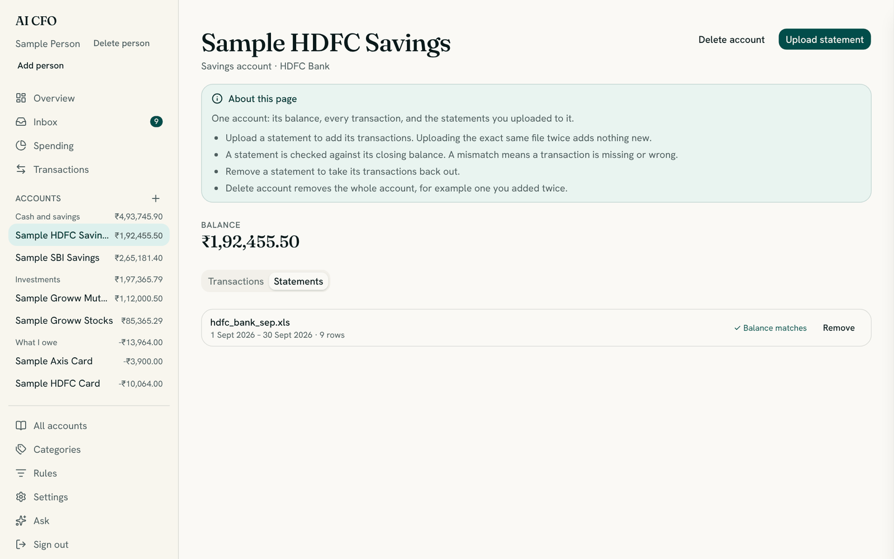

# Statements: what to download and how to upload it

A statement is the file your bank gives you listing what happened in an account. Uploading
statements is how AI CFO learns about your money. This page covers which file to ask for, how to
check you have the right one, what happens when you upload it, and what to do when something is
refused.

New to the app? Do [Getting started](getting-started.md) first.

## Which file to download

| Account | Ask your bank for | File type |
| --- | --- | --- |
| HDFC Bank savings or current | NetBanking account statement | `.xls` or `.csv` |
| HDFC credit card | The billed card statement | `.xls` or `.xlsx` |
| SBI savings or current | Account statement | `.xls`, `.xlsx` or `.csv` |
| Axis credit card | The monthly card statement | `.pdf` |
| Groww mutual funds | Holdings statement or order history | `.xlsx` |
| Groww stocks | Holdings statement or order history | `.xlsx` |

The app also accepts the file types `.csv`, `.xls`, `.xlsx` and `.pdf` generally, but each
account only understands the layout of its own bank. Files can be up to **10 MB** and **20,000
rows**.

### Rules that apply to every file

1. **Use the file exactly as the bank gave it.** Do not open it in Excel and save it again. That
   can change the layout, and the app then does not recognise it.
2. **Do not rename the extension.** The app reads what is really inside the file. Some banks save
   an older `.xls` file under an `.xlsx` name (HDFC card statements do this), and that works.
3. **One account per file.** Upload each statement into the matching account.
4. **Download the full statement, not a summary.** A file with no transactions in it is refused.
5. **A password-protected file is fine.** You enter the password when you upload. It opens the
   file in memory and is never stored.

### What the right file looks like

If you are unsure you downloaded the right thing, open it and compare. You should not edit it, only
look.

| Account | What is inside |
| --- | --- |
| HDFC Bank | A table with the columns **Date**, **Narration**, **Chq./Ref.No.**, **Value Dt**, **Withdrawal Amt.**, **Deposit Amt.** and **Closing Balance**, followed by a row of asterisks. The CSV version uses **Txn Date**, **Withdrawals** and **Deposits** |
| HDFC credit card | A block at the top with **Payment Due Date**, **Statement Date** and **Total Amount Due**, then a table with **Date & Time**, **Description**, **Amt** and **Debit / Credit** |
| SBI | A table with **Date** (or **Txn Date**), **Details** (or **Description**), **Debit**, **Credit** and **Balance** |
| Axis credit card | A PDF with a payment summary at the top (total due, minimum due, due date), then one line per transaction |
| Groww | Holdings files show what you own with an "as on" date. Order history lists your buy and sell orders |

## What happens when you upload

1. The file is opened **in memory**. It is never saved.
2. **Personal details are removed** (names, account and card numbers, phone numbers, UPI handles)
   before anything is stored or sent anywhere.
3. Each row becomes a **transaction** that moves money from one place to another, for example
   "HDFC Savings → Dining".
4. Each transaction is **sorted into a category**: first by your own rules, then by your past
   choices, then by the model if you set a key, and otherwise left **Uncategorized** for you.
5. **Money moving between your own accounts is paired up.** A credit card bill paid from your
   bank appears on both statements. Once both are uploaded, the two halves become one transfer,
   which is neither income nor spending. Until the other side arrives it waits in the Inbox.
6. **The closing balance is checked** against your books, so a missing statement shows up.

You get a summary when it finishes:

| Line | Meaning |
| --- | --- |
| **N rows added to your account** | New transactions |
| **N were already there** | Rows from an earlier upload that overlaps. Nothing is counted twice |
| **N matched a movement from another of your accounts** | A transfer between your accounts, joined up |
| **N need a category** | Rows waiting in the Inbox for you |
| **The statement balance does not match: a statement may be missing** | The books and this statement disagree. See [missing statements](#missing-statements) |

A warning on the summary is not a failure. It is the app telling you something worth a look,
such as:

- **"categorization skipped: no model is configured"**: you have no model key. Rows stay
  Uncategorized, and you sort them yourself.
- **"this exact file was already uploaded for this account; nothing new was added"**: you
  uploaded the same file twice. Harmless.
- **"this statement's card or account number differs from earlier ones for …; check it belongs
  to this account"**: the file may belong to a different account. If you chose the wrong account,
  remove the statement (see below) and upload it into the right one.
- **"original narrations could not be kept for this statement"**: the app could not store the
  readable bank text for these rows. They still import, and you see the cleaned text instead.

## Uploading more than one statement

- **Order does not matter.** Upload a month, then an earlier one, then a later one.
- **Overlap is fine.** Only rows the app has not seen are added.
- **The first statement for an account sets its starting balance**, so the figures match the bank.
- **Cards and banks can be uploaded in either order.** A payment between them waits in the Inbox
  until its other side arrives, then pairs up.

## Missing statements

Each statement shows a closing balance, and the app checks it against your books. If they
disagree, the Inbox shows **"… is short of its statement"**, and the upload summary says **"The
statement balance does not match: a statement may be missing"**. The usual cause is a month you
have not uploaded. Download and upload the missing statement and the message goes away.

## Removing a statement or an account

- **Remove a statement.** Open the account, choose the **Statements** tab, and choose **Remove**
  beside the file. Its transactions and its balance are taken out, and a transfer it had completed
  goes back to waiting for its other side.
- **Delete an account.** Open the account and choose **Delete account**. This is for an account you
  added by mistake, such as one added twice. The dialog says how many transactions and statements
  go with it. It cannot be undone, but you can add the account again and upload the statements
  again.

## Accounts without statements

Some money cannot be uploaded: a fixed or recurring deposit, property, gold, or an account at a
bank the app cannot read yet. Add these with their type and bank, and enter a **Current value**
and an **As of** date. They count toward your net worth.

To keep the value current, open the account and choose **Update value**, then enter what it is
worth today. The change affects your net worth but is **not** counted as income.

## Mutual funds and stocks (Groww)

A Groww holdings file is a snapshot: it records what your investments are worth on a date, not a
list of transactions. Each file reports only one kind of asset, so **mutual funds and stocks are
separate accounts**. If you upload a stocks file into a mutual funds account you see a warning:
*"this is a stocks file but … is a mutual funds account; each holdings type needs its own account
so one upload does not replace the other's value."*

Order history records what you paid for each purchase.

## When an upload is refused

When something is wrong, nothing is imported, and a message says what to do. Here are the
messages and their fixes.

| Message | What it means and what to do |
| --- | --- |
| **This file doesn't look like a … statement.** | The file is not the format for that account. The line under it says which file to upload. Check you chose the right account |
| **… statements are PDFs, but this file is a spreadsheet** (or the other way round) | You downloaded the wrong kind of file. Download the other format |
| **We can't read this kind of file.** | The file is not `.csv`, `.xls`, `.xlsx` or `.pdf`. Download it again in a supported format |
| **We couldn't open this file.** | The file may be damaged, or not the type its name says. Download it again |
| **We couldn't find any transactions in this file.** | The statement covers a period with no activity, or you downloaded a summary. Download the full statement |
| **Row N of the statement … .** | One row has no date, an unreadable amount, or has both a debit and a credit. Nothing was imported. Download the statement again without editing it |
| **A date in this file (…) isn't in a format we understand.** | The file may have been edited and re-saved. Use the file exactly as the bank gave it |
| **This file is password-protected.** | Enter the file's password in the **File password** box and upload again. Banks often use your name, date of birth or card digits |
| **That password didn't open the file.** | The password is wrong. Check it and try again. It is not stored anywhere |
| **That file is too large.** | Statements up to 10 MB are accepted. Upload a shorter period |
| **That file has too many rows.** | Up to 20,000 transactions per file. Upload a shorter period |
| **This account is tracked by hand, so there are no statements to upload.** | That account has no statement format. Use **Update value** instead |
| **We can't read statements for this kind of account yet.** | The app does not read this bank yet. Add the account as a by-hand account |
| **We couldn't safely hide the personal details in this file, so nothing was imported.** | A safety check stopped the upload by design. Try again, and if it keeps happening, quote the reference shown |
| **Add an account first** | Statements go into an account. Finish setup or add one |

## If your bank is not on the list

The app reads the formats in the table at the top of this page. For any other bank:

1. Add the account as **Something else** and enter its **Current value** and **As of** date. It
   then counts toward your net worth.
2. Update its value from time to time with **Update value**.

Adding a reader for another bank is a small, well-bounded change for a developer. See
[CONTRIBUTING](CONTRIBUTING.md#adding-a-bank-adapter).
