# AI CFO user guide

This guide explains every page and feature, for when you want to know what something does. If you
are new, start with [Getting started](getting-started.md), which takes you from nothing to your
first answer step by step.

AI CFO is a personal finance ledger that runs on your own machine. You set up the accounts you
hold, drop in their statements, and it removes personal details, reads them, sorts every
transaction into your categories, and shows what you own, what you owe, where your money went and
how much you can safely spend. You can then ask questions in plain language. Python computes every
figure. The AI only explains figures it was handed.

Under the hood it keeps double-entry books: every transaction moves money from one account to
another, and the two sides always add up. You never have to think about that, but it is why the
numbers on every screen agree with each other.

## Where to find things

| I want to | Read |
| --- | --- |
| Install and set up for the first time | [Getting started](getting-started.md) |
| Know which file to download, and fix an upload | [Statements](statements.md) |
| Ask questions about my money | [The assistant](assistant.md) |
| Change a setting, back up, update, or sign-in details | [Configuration](configuration.md) |
| Fix a problem | [Troubleshooting and FAQ](troubleshooting.md) |
| Look up a word | [Glossary](glossary.md) |

## Setting up

This is also walked through, with screenshots, in [Getting started](getting-started.md#part-2-set-up-your-books). The first time you open the app it asks for your name, and for any family names that should never
leave your machine. You can also choose **Load sample statements** to look around with invented
data instead.

Setup then takes four short steps, and the app returns to it until you finish:

1. **Welcome.** What happens next.
2. **Your accounts.** For each account you hold, pick its **type** (savings, current, cash, credit
   card, loan, fixed or recurring deposit, mutual funds, stocks, property, gold), its **bank or
   provider**, and a **name**. Where the app reads that provider's statements, it says which file
   to download. Accounts without statements (a deposit, a flat, gold, or a bank the app does not
   read yet) ask for their current value and a date instead.
3. **Your categories.** The default categories are listed with a line on what each is for. Click a
   name or description to change it, or **＋ Add category**: give it a name, say whether it is
   money going out or coming in, optionally put it inside another category, and write one line on
   what it is for. That line is also what the categorizer reads, so a clear description means
   better automatic sorting. **Use these categories** moves on.
4. **Done.** **Add your first statement** opens your first account with the upload ready.

Add more accounts or categories any time from the sidebar.

To add or remove people, see [More than one person](#more-than-one-person).

## Getting around

The sidebar is always on the left:

| Item | What it is for |
| --- | --- |
| **Overview** | Four things: net worth, money in and out for the latest month (net in, net out, saved), safe to spend, and the top of the Inbox |
| **Inbox** | Everything that needs you, each with its fix. The number beside it is how many |
| **Spending** | One month: net in, net out and saved, where it went by category, and spending that grew |
| **Transactions** | Everything that happened, searchable (press `/`), filterable by account and category |
| **Accounts** | Your accounts grouped as cash and savings, investments, deposits, other assets, and what you owe, with balances. Click one to open it |
| **All accounts** | The books in accounting terms: Assets, Liabilities, Income, Expenses and Equity, each totalled over all time |
| **Categories** | Rename, describe, add, merge, retire or delete categories |
| **Rules** | "If the narration contains this text, use this category", checked from the top |
| **Settings** | Safe-to-spend settings, privacy, and starting over |
| **Ask** | Opens the assistant on the right, beside the page |

On a phone the sidebar opens from the menu button at the top.

Every page starts with an **About this page** note that says what the page shows and what you can
do there. Click its title to close it; it stays closed on that page until you open it again.

## A closer look at each page

Every page opens with an **About this page** note. Click its title to close it. It stays closed
on that page until you open it again.

### Overview

Four things: your net worth, the latest month's money in and out, how much is safe to spend, and
the top of your Inbox.

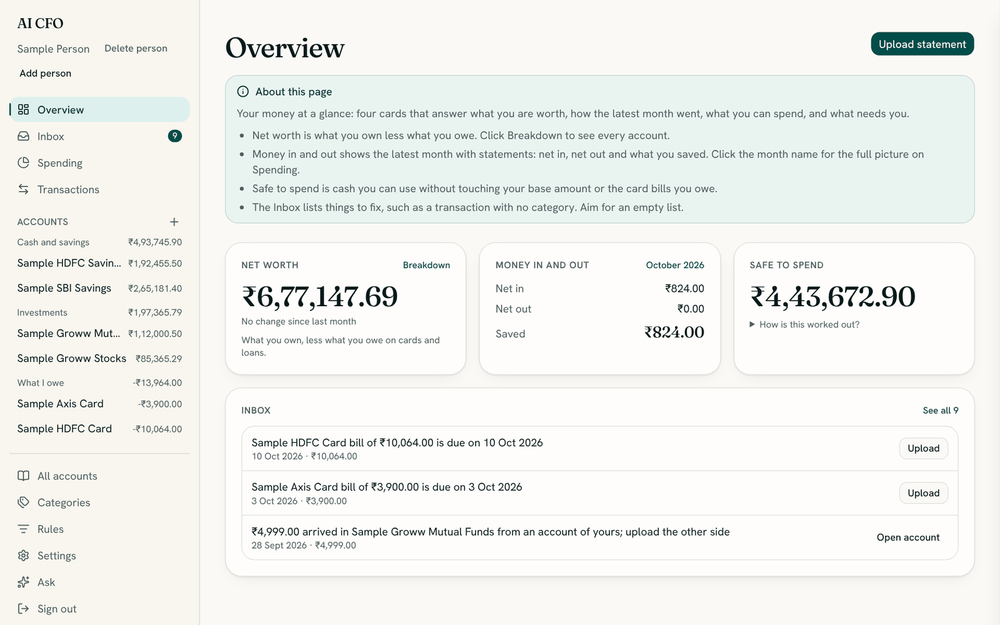

### Inbox

Everything that needs you, each with its fix beside it: a button to **Upload** a missing
statement, **Choose category**, **Pay a card**, or **Open account**. The number beside **Inbox** in
the menu is how many items there are.

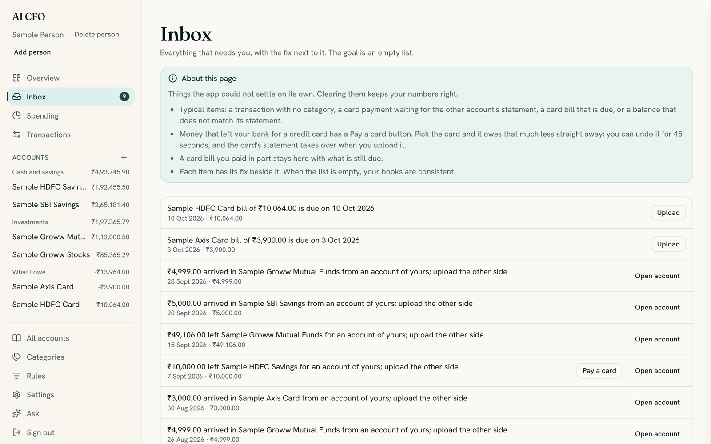

### Spending

One month of money in and out. Use the **arrows** beside the month name to move between months.

- **Net in**, **Net out** and **Saved** are the three cards at the top.
- The line under them, such as "Net worth changed by ₹1,15,619.00: saved ₹1,15,619.00 ✓", is the
  **check line**. It proves the month's figures add up to the change in what you own.
- **Where it went** lists spending by category, biggest first, with sub-categories indented.
  Click a category to see the transactions behind it. **Where it came from** lists income.
- **Spending that grew** shows payees that cost more than usual.

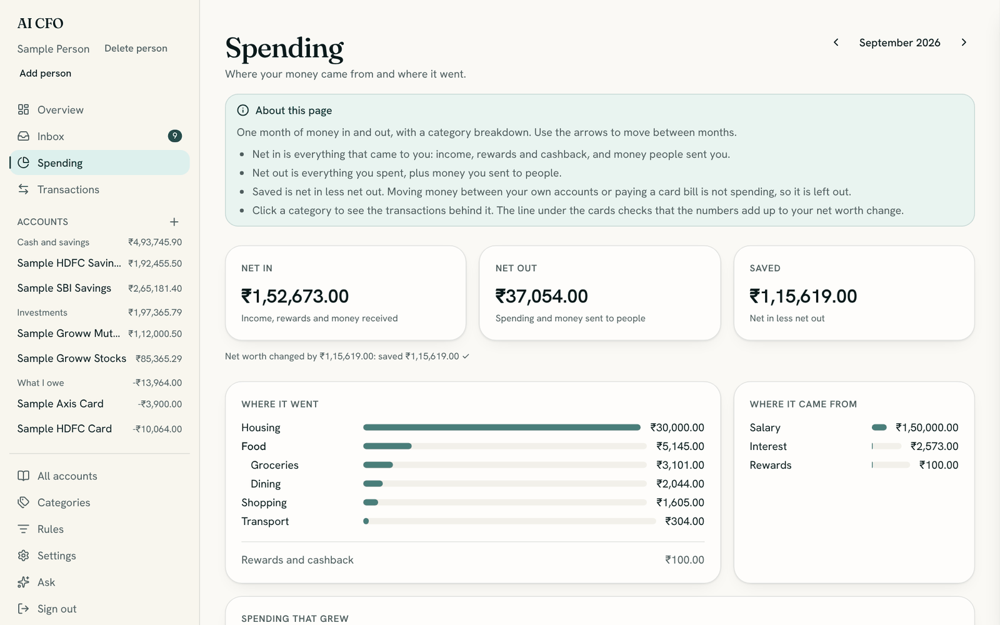

### Transactions

Every transaction from every statement, newest first.

- **Search** by description (press `/` to jump to the search box), or filter by **account** or
  **category**.
- **From → To** shows where the money moved. "Sample HDFC Card → Groceries" is a purchase.
  "Money in transit → …" is a payment from another account of yours that is waiting for the
  other side. The category then reads **Own account: waiting**.
- **Open a row** (the arrow at its left) to see its **Bookkeeping**: the original text with
  personal details hidden, each side of the transaction and where it came from (the statement,
  the categorizer, or you), and **Ignore this row**, which drops a duplicate for good.
- Click a row's category to change it, and tick **Always do this** to make a rule.

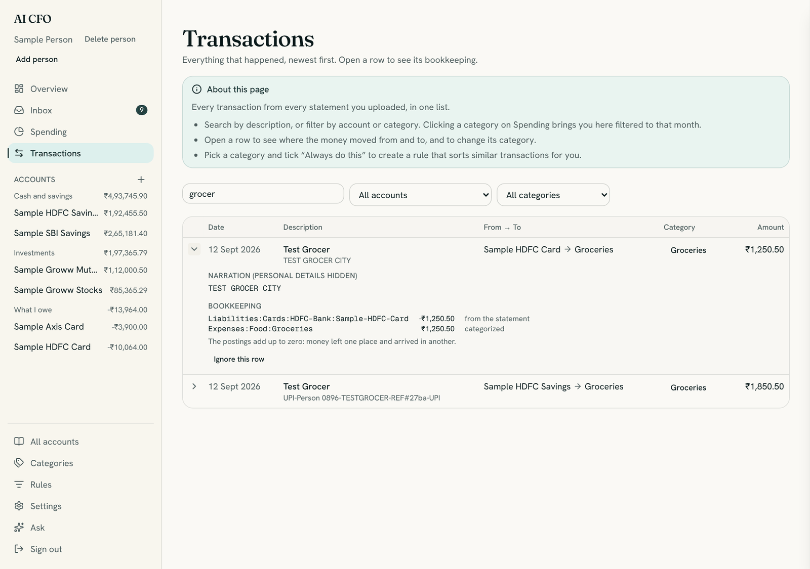

### An account

Click an account in the left menu. You see its balance and two tabs: **Transactions** (a running
balance beside each row) and **Statements** (each uploaded file, with **Remove**). **Upload
statement** adds a file. For an account you keep up by hand, **Update value** appears instead.
**Delete account** is for one you added by mistake.

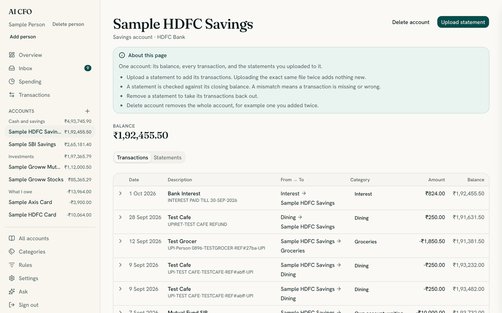

### All accounts

Your books in accounting terms: **Assets**, **Liabilities**, **Income**, **Expenses** and
**Equity**, each totalled over all time. You rarely need it, but it is how you can check any number
back to its source.

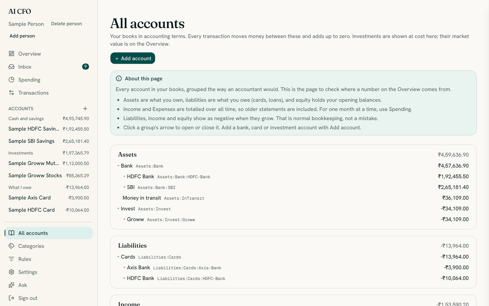

### Categories

Rename a category or edit its description by clicking it. **＋ Add category** makes a new one.
**Merge** folds one category into another. **Retire** hides one you no longer use. **Delete** works
only on a category with no transactions.

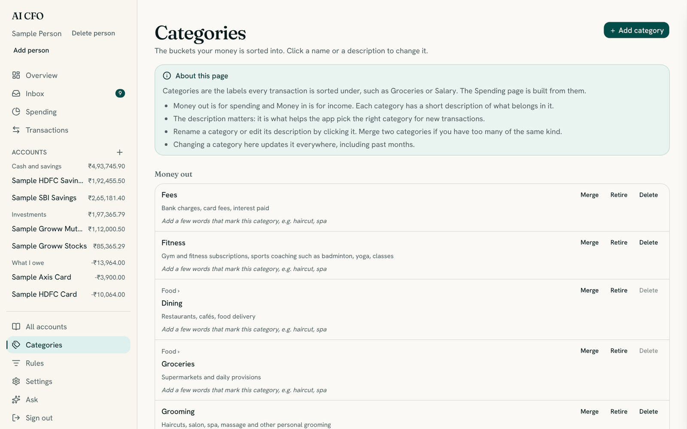

### The Rules page

A rule says "if the narration contains this text, use this category". The list is checked from the
top and the first match wins. Use the arrows to reorder, **Edit** to change, and **Delete** to
remove. **＋ Add rule** opens a form where you choose whether the narration **contains** or **starts
with** your text, whether the rule applies to money in, money out or both, and the category. It
tells you how many existing transactions it would match.

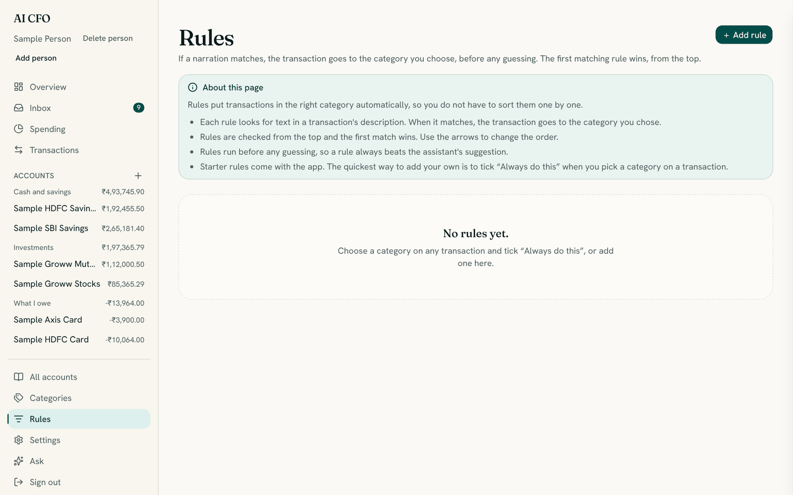

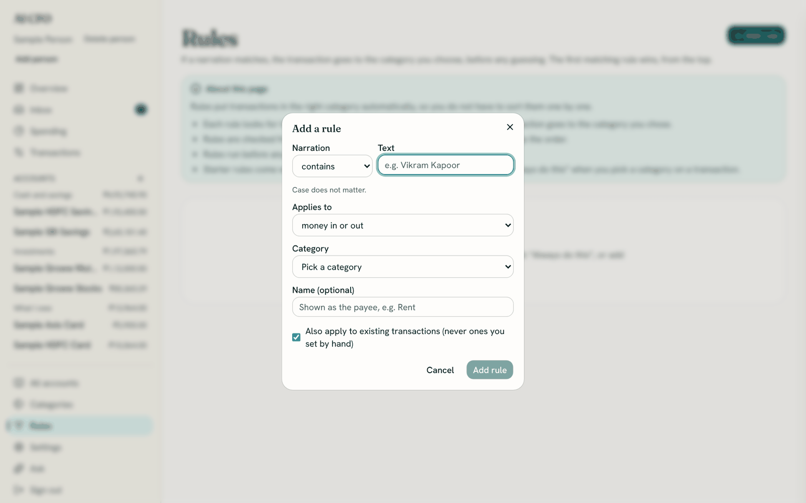

### Settings

Two numbers shape **Safe to spend**: the **Base amount kept aside** (an emergency cushion it never
counts) and an optional **Monthly allowance**. Below them are the privacy controls (see
[Privacy](#privacy-what-is-stored-and-what-is-sent)).

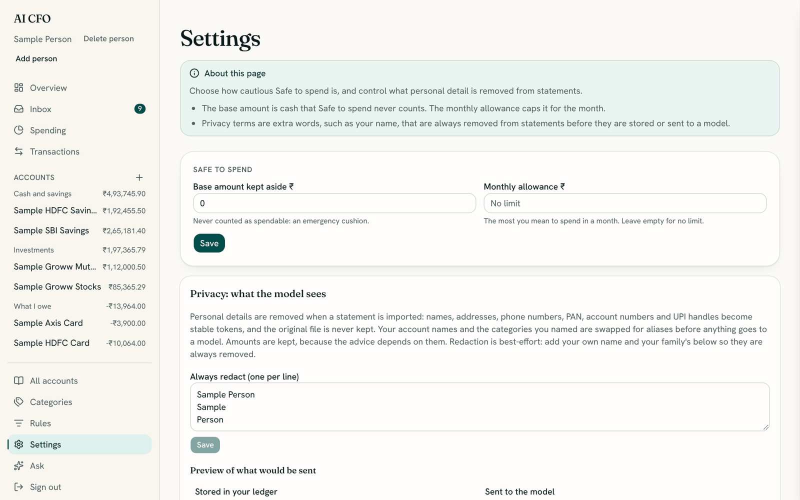

### More than one person

Each person has their own books. **Add person** sits under the name at the top of the menu.

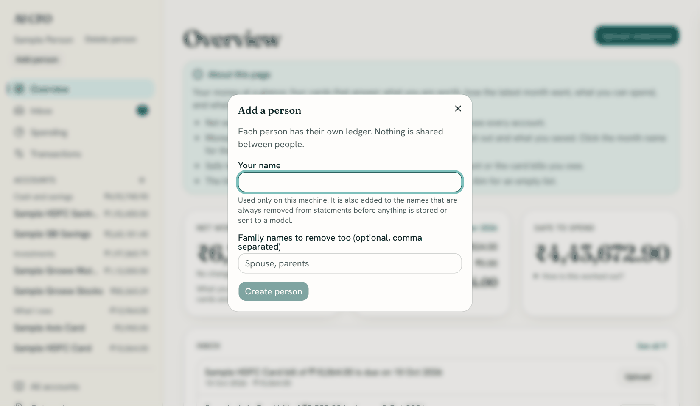

**Delete person** removes the person you are viewing and everything in their ledger: accounts,
transactions, uploaded statements, rules and privacy names. You type their name to confirm, and it
cannot be undone. Nobody else's books change.

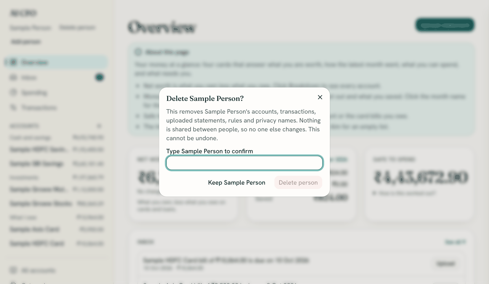

### On a phone

The menu opens from the button at the top left.

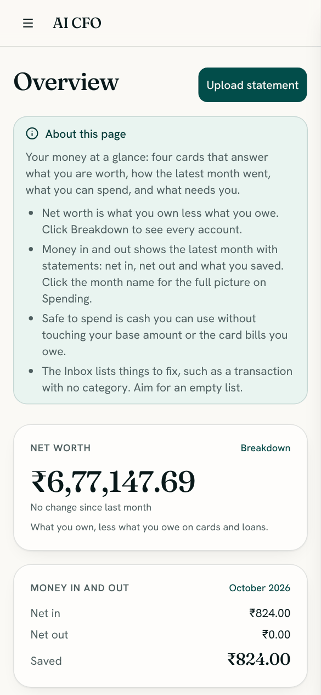

## Statements

Open an account and choose **Upload statement**. The file is read in memory and never kept. [Statements](statements.md) has the detail: what each file looks like, every message you might see, and what to do when a bank is not on the list.

| Provider | What to download |
| --- | --- |
| HDFC Bank account | NetBanking statement, `.xls` or `.csv` |
| HDFC credit card | Billed statement, `.xls` or `.xlsx` |
| SBI account | Account statement, `.xls`, `.xlsx` or `.csv` |
| Axis credit card | Monthly statement PDF |
| Groww | Holdings statement or order history, `.xlsx` (mutual funds and stocks are separate accounts) |

A password-protected file asks for its password, which opens the file in memory and is never
stored.

What happens to a statement:

- **Every row becomes a transaction** from one place to another: "HDFC Savings → Dining", "Salary →
  HDFC Savings". The account side comes from the statement; the category is your remembered choice
  for that description, or the categorizer's, or **Uncategorized** if neither is sure.
- **Money between your own accounts pairs up.** A card bill paid from savings shows on both
  statements. Once both are uploaded the two halves become one transfer, "HDFC Savings → HDFC
  Card", which is neither income nor spending. Until the other side arrives it waits in the Inbox.
- **The closing balance is checked.** The first statement for an account sets its starting balance
  so the figures match the bank. Later statements are checked against the books; a mismatch means a
  statement is missing, and the Inbox says by how much.
- **Uploading the same file twice adds nothing**, and overlapping statements add only the new rows.
- Holdings statements record what your investments are worth; order files record what you paid.

The upload summary says how many rows were added, how many were already there, how many matched a
movement from another account, and how many need a category.

**Removing a statement** (account page, **Statements** tab, **Remove**) takes out its rows and its
balance. A transfer it completed goes back to waiting for its other side.

**Deleting an account** (account page, **Delete account**) is for an account you added by mistake,
such as one added twice. The dialog says how many transactions and statements will go. They are
removed with the account, and a movement it shared with another account stays on that account,
waiting for its other side. Your other accounts are not changed. It cannot be undone, but you can
add the account again and upload its statements.

## The Inbox

| Item | What to do |
| --- | --- |
| **Needs a category** | **Choose category**. The choice is remembered for the same description in later statements, and applied to other rows like it |
| **Left … for an account of yours** / **Arrived in … from an account of yours** | Upload the statement of the other account. If it is not one of your accounts, choose a category instead. If money left your bank to pay a credit card, click **Pay a card** (see below) |
| **… is short of its statement** | A statement is missing for that period. Upload it |
| **Card bill … is due** | Shows until payments to the card since the statement date cover it. If you paid part of it, it says how much is still due, for example "₹2,111.86 of the ₹12,111.86 bill is still due" |

### Paying a credit card

There are two ways to settle a card bill, and they work together.

- **Upload the card's statement.** Its payment line pairs with the matching payment from your bank.
- **Say which card a bank payment was for.** On a row that left your bank account (for example a
  CRED payment), click **Pay a card** in the Inbox, or open **Choose category** and pick a card
  under **Pay a credit card**. The card shows what it owes now, and the card that owes exactly the
  amount (or exactly what is left of its bill) is marked **Matches this payment**. The card owes
  that much less straight away, the bill leaves the Inbox once your payments cover it, and
  Net worth and Spending do not change: it is a payment, not an expense. The Transactions page
  shows the row as "Paid to *card* · awaiting statement".

When you later upload the card's statement, its line for the same payment (the same card, the same
amount, within three days) replaces the one you recorded, so nothing is counted twice. A payment
with a different amount is never matched by guesswork: both stay visible, and the statement's
balance check shows the difference.

**Picked the wrong card?** A message at the bottom of the screen offers **Undo** for 45 seconds. It
puts the row back exactly as it was. After that, open the row's category button and pick the
right card; that moves the payment. Once the card's statement has matched the payment, it is a
confirmed movement and cannot be changed this way. Only money that left a bank or cash account,
and is not already matched, can pay a card, and a card payment is recorded one at a time, never as
a rule.

### Rules

Open **Rules** to say "if a narration contains this text, put it in this category", for example a
payee's name for rent. When you choose a category on a transaction, tick **Always do this** to
make that a rule. Rules run before any guessing, the first match from the top wins, and they never
change a transaction you set by hand. A rule can also send a row to **Between your accounts**: a
credit card bill paid from your bank (through CRED, directly or by UPI) is then a transfer, not
spending, and pairs with the payment on the card's statement. A few starter rules cover common card
payment wording. Categories also take a few **keywords** (click under the description).

## The figures

- **Net worth** is everything you own minus everything you owe. Credit card balances and loans
  reduce it. Investments count at their latest market value.
- **Net in, net out, saved** cover one month. Net in is income plus cashback and money people sent
  you; net out is spending plus money you sent to people; saved is the difference. Moving money
  between your own accounts is neither. Under **Where it went**, money to and from people and
  cashback are listed on their own lines rather than as categories.
- **The month shown** is the current month once it has statements, otherwise the latest month that
  does, so the Overview and Spending never show an empty month while last month's figures exist.
- **The check line** on Spending reads "Net worth changed by … : saved … ✓". It proves the month's
  figures agree with the change in what you own; revaluations and opening balances are listed when
  they play a part.
- **Safe to spend** is your cash and savings, minus the base amount you keep aside, minus what you
  owe on credit cards, capped by your monthly allowance if you set one. **How is this worked out?**
  on the Overview shows each step. Set the base amount and allowance in **Settings**.
- **Deposits, property and gold** change only when you **Update value** on their page. The change
  counts toward net worth, not income.
- **Transactions** open to a **Bookkeeping** panel showing every side of the transaction and where
  each came from (the statement, the categorizer, or you). **Ignore this row** drops a duplicate
  for good.

## Privacy: what is stored and what is sent

Before a statement is parsed, a redactor removes personal details: names, addresses, phone numbers,
email, PAN, account and card numbers, and UPI handles. Each becomes a stable token such as
`[PERSON:ab12]`. The same payee always gets the same token, so grouping and de-duplication still
work. The original file is never kept, and tokens cannot be turned back into the details.
The one exception is each row's original narration, so you can tell what a row is: it is kept
encrypted in your database (see below), shown only to you, and never sent to a model.

Amounts, dates, and merchants stay readable. For UPI, IMPS, and NEFT, the other party's name is
redacted when it looks like a person and kept when it looks like a business.

Redaction is best-effort. In **Settings**, the privacy section has:

- **Always redact**: your own names. Add any name that should never appear, one per line.
- **Preview**: each recent description as stored and as it would be sent to a model.
- **Names for redacted people and numbers**: give a token a name such as "Landlord". The name
  appears only to you. A model only ever sees the token.

Your account names, institutions and the names of categories you created are swapped for aliases
before anything reaches a model, and the assistant's replies are shown with your names put back.

**Original narrations.** Each row's bank text is stored encrypted (`posting_originals`) with a
key from `NARRATION_KEY`, or one generated into a Docker volume on first run. Back the key up
with your database: without it the app falls back to the redacted text. Removing a statement
removes its originals. To keep none, run without a key.

Two things leave your machine: redacted statement lines (and your category descriptions) to the
categorizer, and figures with aliases to the chat model. Consider asking your provider to enable
zero data retention. Only the owner can sign in (see [Sign-in](configuration.md#sign-in)). The app also binds to `127.0.0.1` and refuses other hosts and cross-site writes.

## Asking questions

**Ask** opens the assistant beside the page. It reads your ledger through nine tools and explains
what they returned: what stands out, why, and what to do next. It can compare your cards and bank
accounts ("which credit card had the most spending?"), look at one payee or category over any
period ("how much on Swiggy?"), find your regular monthly payments, and more.

It needs a model key. Without one, a question gets the reply "the assistant could not answer", and
everything else keeps working.

The [assistant guide](assistant.md) lists what you can ask, how to read an answer, what it counts
and does not count, what it cannot do, and how it protects your privacy.

## A typical month

| When | What to do |
| --- | --- |
| Start of the month | Upload last month's bank and card statements |
| After uploading | Clear the Inbox: categorize what is new, upload any missing other side |
| Any time | Update the value of deposits or property; adjust categories |
| Mid-month | Check Safe to spend on the Overview |

You do not need to upload everything at once, or in order.

## Problems

[Troubleshooting and FAQ](troubleshooting.md) is organised by the stage where you are stuck:
starting the app, signing in, setup, uploading, the Inbox, figures that look wrong, the assistant,
and backups.

## For developers

Running the tests, the code layout, migrations and the HTTP API are in the
[developer docs](README.md#for-developers).
